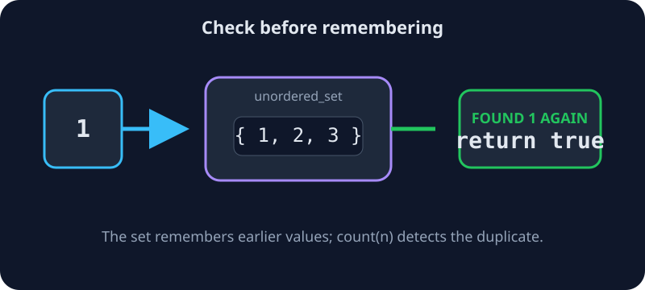

# 1. Contains Duplicate

## 1. Problem Statement
- Given an array of integers, determine whether any value appears more than once.
- Example: `[1, 2, 3, 1] -> true`; `[1, 2, 3, 4] -> false`
- Constraints: The code supports integer values and an empty or one-element array.

## 2. Pattern / Category
- Hash Set
- A set lets the code remember values already seen and detect a repeated value in constant average time.

## 3. Intuition
- When reading the array, immediately ask: "Have I seen this number before?"
- Store each number after checking it, because that makes a duplicate detectable as soon as it appears.



## 4. Brute Force Approach
- Compare every number with every later number using nested loops.
- Time: O(n^2); Space: O(1).
- It repeatedly compares pairs and becomes slow as the array grows.

## 5. Optimal Approach (My Solution)
1. Reserve space in `numsSet` for the array size.
2. Visit each number `n`.
3. If `n` is already in the set, return `true`.
4. Otherwise insert `n`.
5. Return `false` after all values are checked.
- `numsSet`: stores values encountered earlier; `n`: the current array value.

Dry run for `[1, 2, 3, 1]`:

| n | Set before | Action |
|---|---|---|
| 1 | `{}` | Insert |
| 2 | `{1}` | Insert |
| 3 | `{1, 2}` | Insert |
| 1 | `{1, 2, 3}` | Found -> `true` |



## 6. Code
```cpp
class Solution {
public:
    bool containsDuplicate(vector<int>& nums) {
        unordered_set<int> numsSet;
        numsSet.reserve(nums.size()); // Prepare storage for the array size

        for (int n : nums) {
            if (numsSet.count(n)) { // Seen before
                return true;
            }
            numsSet.insert(n); // Remember this value
        }
        return false;
    }
};
```

## 7. Complexity Analysis
- Time complexity: O(n) on average, because each value is checked and inserted in average constant time.
- Space complexity: O(n), because the set can store every distinct value.

## 8. Edge Cases
- Empty array: no number is found; returns `false`.
- Single element: it is inserted once and no duplicate exists; returns `false`.
- Repeated values: the second occurrence triggers `true`.
- Negative numbers: the set works the same way.

## 9. Common Mistakes / Pitfalls
- Returning `false` as soon as a value is first seen instead of only after the full scan.
- Forgetting to insert values after checking them.
- Assuming duplicates can be found without storing prior values.

## 10. Key Takeaways
- Insert and check: use a set for exact duplicate detection.
- Return immediately when the first duplicate is found.
- A set trades extra space for faster lookup.

## 11. Related Problems
- Valid Anagram
- Two Sum
- Contains Duplicate II

## 12. 30-Second Interview Explanation
I scan the array once while keeping every value already seen in an unordered set. For each number, I check whether it is already present and return `true` immediately if so. Otherwise, I insert the number and continue. If the scan finishes without a match, the array has no duplicates. This gives average linear time and linear extra space.
