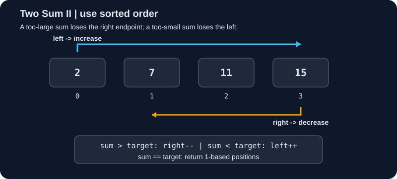

# 10. Two Sum II - Input Array Is Sorted

## 1. Problem Statement
Find two values in an ascending sorted array that sum to `target`, returning their 1-based positions; `[2,7,11,15]`, target 9 gives `[1,2]`. Source tests include negatives and demonstrate a solution; the method assumes sorted input.

## 2. Pattern / Category
Two pointers on a sorted array.

## 3. Intuition
If the endpoint sum is too large, move the right pointer lower; if too small, move the left pointer higher.


## 4. Brute Force Approach
Try every pair: O(n²) time and O(1) extra space. The source instead uses sorted order to eliminate a side each step.

## 5. Optimal Approach (My Solution)
`left` starts at 0 and `right` at the last index. Each loop computes `sum`; when above target it decrements `right`, when below it increments `left`, and when equal returns `{left+1,right+1}`. If the pointers meet without a match, it returns `{}`.

Dry run for `{2,7,11,15}`, target 9: `2+15` is too large, so `right` moves left; `2+11` is still too large; `2+7=9`, returning `{1,2}`.



## 6. Code
```cpp
class Solution {
public:
    vector<int> twoSum(vector<int>& numbers, int target) {
        int left = 0, right = numbers.size()-1;
        int sum = 0;
        while (left<right)
        { 
          sum = numbers[left]+numbers[right];
          if(sum>target){
            right--;
            continue;
          }
          if(sum<target){
            left++;
            continue;
          }
          if(sum==target){
            return {left+1,right+1};
          }
        }
        return {};
    }
};
```

## 7. Complexity Analysis
O(n) time and O(1) auxiliary space.

## 8. Edge Cases
- Negative values are handled by the same comparisons.
- The method expects sorted input and a valid pair for the usual problem contract.
- Empty input returns `{}` on typical implementations; the initial last index uses `size()-1`.

## 9. Common Mistakes / Pitfalls
- Returning zero-based indices instead of the required 1-based positions.
- Moving the wrong pointer for a too-large or too-small sum.
- Applying this elimination rule to an unsorted array.

## 10. Key Takeaways
Sorted order makes each sum comparison determine which endpoint to move.

## 11. Related Problems
- Two Sum
- 3Sum
- Container With Most Water

## 12. 30-Second Interview Explanation
I place pointers at the two ends of the sorted array. If their sum is above the target, I reduce the right value; if below, I increase the left value. On equality I return the two indices plus one. For the source example, the pointers eventually reach 2 and 7 and return `[1,2]`.
