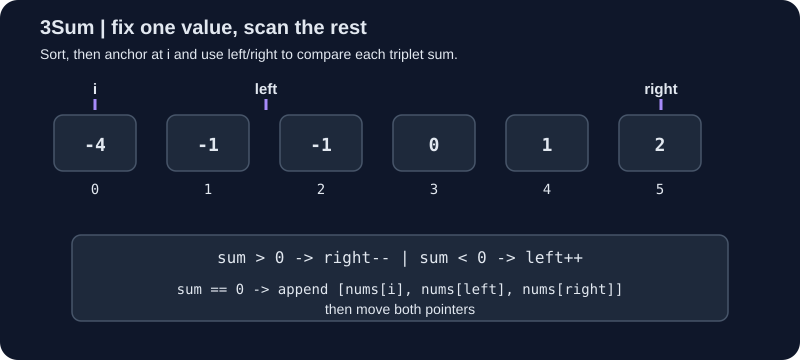

# 11. 3Sum

## 1. Problem Statement
Find triplets of array values whose sum is zero; `[-1,0,1,2,-1,-4]` includes `[-1,-1,2]` and `[-1,0,1]`. Source tests include duplicates and empty input; values are integers and the implementation may return duplicate triplets.

## 2. Pattern / Category
Sorting + two pointers.

## 3. Intuition
After sorting, fix one value and move two pointers to raise or lower the triplet sum.


## 4. Brute Force Approach
Try every triple and record zero-sum triples: O(n³) time, plus output storage. This baseline is not the source implementation.

## 5. Optimal Approach (My Solution)
The code sorts `nums` in place. For each `i`, it starts `left=i+1` and `right=last`; it decrements `right` for positive sums and increments `left` for negative sums. For zero, it appends the three values to `allThreeSums` and moves both pointers once. It does **not** skip duplicate fixed values or duplicate pointer values, so duplicate triplets can appear.

Dry run for source case `{-1,0,1,2,-1,-4}`: after sorting to `[-4,-1,-1,0,1,2]`, the first fixed `-1` produces `[-1,-1,2]` and `[-1,0,1]`; the next fixed `-1` can produce `[-1,0,1]` again because the code does not skip duplicates.



## 6. Code
```cpp
class Solution {
public:
    vector<vector<int>> threeSum(vector<int>& nums) {
        sort(nums.begin(),nums.end());
        vector<vector<int>> allThreeSums;
        int left = 0, right = 0, sum = 0;
        for(int i=0; i<nums.size();i++){
          left = i+1, right = nums.size()-1;
          while(left<right){
            sum = nums[i] + nums[left] + nums[right];
            if(sum>0){
              right--;
              continue;
            }
            if(sum<0){
              left++;
              continue;
            }
            if(sum==0){
              allThreeSums.push_back({nums[i],nums[left],nums[right]});
              left++; 
              right--;
            }
          }
        }
        return allThreeSums;
    }
};
```

## 7. Complexity Analysis
O(n²) scan after O(n log n) sorting; O(log n) auxiliary sorting stack, plus output space (which can be O(n²) in the worst case, including duplicate outputs).

## 8. Edge Cases
- Empty or fewer than three values returns no triplets.
- All zeros can produce repeated `[0,0,0]` results because duplicates are not skipped.
- Sorting changes the input vector's order.

## 9. Common Mistakes / Pitfalls
- Claiming unique triplets: the source does not deduplicate.
- Failing to sort before applying the pointer movement rules.
- Moving only one pointer after finding a zero sum can stall or repeat pairs.

## 10. Key Takeaways
Sorting enables an O(n²) two-pointer scan, but this implementation returns every zero match it encounters, including duplicates.

## 11. Related Problems
- Two Sum II
- 4Sum
- 3Sum Closest

## 12. 30-Second Interview Explanation
I sort the array, fix each index `i`, and scan the remaining suffix with `left` and `right`. A positive sum moves `right` inward; a negative sum moves `left`; zero adds a triplet and moves both. This is O(n²), but unlike a typical unique-triplet solution, the source has no duplicate-skipping logic.
