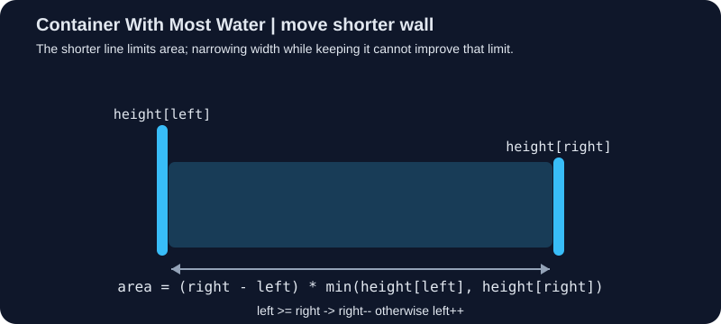

# 12. Container With Most Water

## 1. Problem Statement
Given nonnegative heights, choose two positions maximizing width times the shorter height; `[1,8,6,2,5,4,8,3,7]` gives area 49. Source tests include one height and equal heights; the code returns 0 when fewer than two bars are present.

## 2. Pattern / Category
Greedy two pointers.

## 3. Intuition
The shorter side limits area, so moving the taller side cannot improve the limiting height; move the shorter side inward.


## 4. Brute Force Approach
Evaluate every pair of lines: O(n²) time and O(1) extra space. This is only a baseline, not the source solution.

## 5. Optimal Approach (My Solution)
`left` and `right` start at the ends. Each iteration computes `cHeight=min(height[left],height[right])`, `width=right-left`, and `area`; it updates `maxArea`. The code decrements `right` when the left height is at least as large, otherwise it increments `left`.

Dry run for `{1,8,6,2,5,4,8,3,7}`: endpoint area is `8*1=8`; moving the shorter left side eventually reaches height 8 at index 1 and height 7 at index 8, giving `7*7=49`, the maximum.



## 6. Code
```cpp
class Solution {
public:
    int maxArea(vector<int>& height) {
      int left = 0;
      int right = height.size()-1;
      int area = 0, maxArea = 0,  cHeight = 0, width = 0;
      while (left<right)
      {
        cHeight = height[left] < height[right] ? height[left] : height[right];
        width = right - left;
        area = width * cHeight;
        maxArea = maxArea > area ? maxArea : area;
        if(height[left]>=height[right]){
          right--;
        } else{
          left++;
        }
      }
      return maxArea;
    }
};
```

## 7. Complexity Analysis
O(n) time and O(1) auxiliary space.

## 8. Edge Cases
- Fewer than two heights returns 0 because the loop does not execute.
- Zero heights contribute zero area.
- The code assumes heights and area fit in `int`.

## 9. Common Mistakes / Pitfalls
- Moving the taller wall instead of the shorter one.
- Using the taller height in the area formula.
- Confusing width `right-left` with `right-left+1`.

## 10. Key Takeaways
At each step, discard the side that currently limits the area.

## 11. Related Problems
- Trapping Rain Water
- Two Sum II
- Largest Rectangle in Histogram

## 12. 30-Second Interview Explanation
I start at both ends, compute the area using the shorter height and current width, and keep the maximum. Since the shorter line limits the container, I move that pointer inward (the source moves right on equal heights). The test case with heights `[1,8,6,2,5,4,8,3,7]` reaches area 49.
