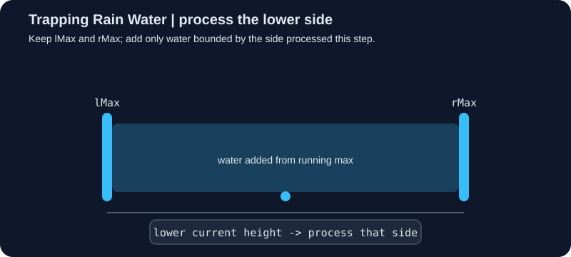

# 13. Trapping Rain Water

## 1. Problem Statement
Given nonnegative bar heights, compute trapped water; `[0,1,0,2,1,0,1,3,2,1,2,1]` gives 6. Source cases include empty input and monotonic bars; heights are nonnegative integers.

## 2. Pattern / Category
Two pointers with running boundary maxima.

## 3. Intuition
Water above a side is determined by the lower of the best boundaries; process the side with the smaller current height.


## 4. Brute Force Approach
For each index, scan left and right for the highest walls and add `min(leftMax,rightMax)-height[i]`: O(n²) time and O(1) extra space. This is a baseline, not the source solution.

## 5. Optimal Approach (My Solution)
The empty-input guard returns 0. `lMax` and `rMax` start at the endpoint heights. While `l<r`, if `height[l]<height[r]`, update `lMax`, add `lMax-height[l]`, and advance `l`; otherwise do the symmetric operation for `rMax` and `r`.

Dry run from source case `[2,0,2]`: endpoints are both 2, so the code processes the right side first, adding `2-2=0`. Now the right pointer is on height 0, and the next step adds `rMax-height[r]=2`; the result is 2.



## 6. Code
```cpp
class Solution
{
public:
  int trap(vector<int> &height)
  {
    if (height.empty())
      return 0;
    int l = 0, r = height.size() - 1;
    int area = 0;
    int lMax = height[l], rMax = height[r];
    while (l < r)
    {
      if (height[l] < height[r])
      {
        lMax = max(lMax , height[l]);
        area += lMax - height[l];
        l++;
      }
      else
      {
        rMax = max(rMax , height[r]);
        area += rMax - height[r];
        r--;
      }
    }
    return area;
  }
};
```

## 7. Complexity Analysis
O(n) time and O(1) auxiliary space.

## 8. Edge Cases
- Empty input returns 0.
- Monotonically increasing/decreasing heights trap no water.
- The code uses `int` for the total, so it assumes the result fits in `int`.

## 9. Common Mistakes / Pitfalls
- Processing the taller side when the shorter side is the known limiting boundary.
- Forgetting to update a running maximum before adding trapped water.
- Counting water at endpoints.

## 10. Key Takeaways
Running maxima and inward-moving pointers avoid storing separate left/right arrays.

## 11. Related Problems
- Container With Most Water
- Product of Array Except Self
- Largest Rectangle in Histogram

## 12. 30-Second Interview Explanation
I keep `lMax` and `rMax`, then process whichever current end is lower. Its water level is determined by the running maximum on that side, so I add that difference and move inward. For `[2,0,2]`, the right pointer moves onto height 0 and contributes 2; total trapped water is 2.
