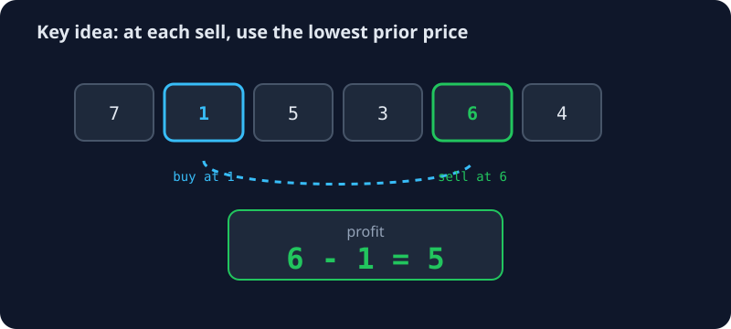

# 14. Best Time to Buy and Sell Stock

## 1. Problem Statement
Given daily prices, choose one earlier buy and one later sell to maximize profit; `[7,1,5,3,6,4]` gives 5, while decreasing prices give 0. Source tests include one day and empty input; only one transaction is modeled.

## 2. Pattern / Category
One-pass greedy; running minimum.

## 3. Intuition
For each sell price, the best buy seen earlier is the minimum price so far.


## 4. Brute Force Approach
Try all buy/sell day pairs with buy before sell: O(n²) time and O(1) extra space. This baseline is not in the source.

## 5. Optimal Approach (My Solution)
An empty vector returns 0. `minPrice` starts at `prices[0]`, `maxProfit` at 0. For every `price`, the code first updates `minPrice=min(price,minPrice)`, then updates profit with `price-minPrice`.

Dry run from `[7,1,5,3,6,4]`: `minPrice` becomes 1 on day 1; at price 6, `6-1=5` sets `maxProfit` to 5; later prices do not improve it.



## 6. Code
```cpp
class Solution {
public:
  int maxProfit(vector<int>& prices) {
    if (prices.size()==0)
    {
      return 0;
    }
    int minPrice = prices[0];
    int maxProfit = 0;
    for(int price: prices){
      minPrice = min(price, minPrice);
      maxProfit = max(maxProfit, price - minPrice);
    }
    return maxProfit;
  }
};
```

## 7. Complexity Analysis
O(n) time and O(1) extra space.

## 8. Edge Cases
- Empty and one-day input return 0.
- Decreasing or constant prices never raise `maxProfit` above 0.
- The buy/sell order is enforced by tracking only prices seen so far.

## 9. Common Mistakes / Pitfalls
- Updating the best profit using a future minimum.
- Allowing negative profit instead of retaining the initial zero.
- Treating multiple transactions as allowed; this method models one buy/sell.

## 10. Key Takeaways
Track the cheapest prior buy and evaluate each current price as a possible sell.

## 11. Related Problems
- Best Time to Buy and Sell Stock II
- Maximum Subarray
- Trapping Rain Water

## 12. 30-Second Interview Explanation
I scan prices once, maintaining the smallest price seen and the best profit so far. At each price I update the minimum, then compare `price-minPrice` with `maxProfit`. The source example's minimum becomes 1 and selling at 6 gives profit 5; empty input is handled separately.
