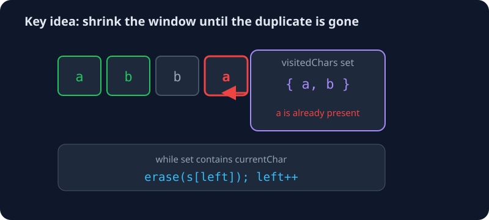

# 15. Longest Substring Without Repeating Characters

## 1. Problem Statement
Return the length of the longest contiguous substring with no repeated character; `"abcabcbb"` gives 3. Source tests include empty strings, repeated characters, and spaces; characters are stored as `char`.

## 2. Pattern / Category
Sliding window + hash set.

## 3. Intuition
Maintain a window with unique characters; when a duplicate appears, remove from its left until it is safe to add.


## 4. Brute Force Approach
Enumerate each substring and check its characters for duplicates: O(n³) with a fresh check, or O(n²) with incremental checking; extra space can be O(min(n, alphabet)). This is only a baseline.

## 5. Optimal Approach (My Solution)
`left` and `right` delimit the window and `visitedChars` stores its characters. For `s[right]`, the code erases `s[left]` and advances `left` while that character is already present; it then inserts the current character, updates `ans` with `right-left+1`, and increments `right`.

Dry run from `"abba"`: add `a`, then `b` (length 2); on the second `b`, erase `a` and the earlier `b`, advance left to index 2, then add `b`. The longest length remains 2.



## 6. Code
```cpp
class Solution
{
public:
  int lengthOfLongestSubstring(string s)
  {
    unordered_set<char> visitedChars;
    int left = 0, right = 0, ans = 0;
    while (right < s.size())
    {
      char currentChar = s[right];
      while (visitedChars.count(currentChar))
      {
        visitedChars.erase(s[left]);
        left++;
      }
      visitedChars.insert(currentChar);
      ans = max(ans, right - left + 1);
      right++;
    }
    return ans;
  }
};
```

## 7. Complexity Analysis
O(n) average time: each character enters and leaves the set at most once; set operations are average O(1). Space is O(min(n, distinct character count)), at most O(n).

## 8. Edge Cases
- Empty string returns 0.
- All-identical input returns 1.
- A single space is a character and returns 1.

## 9. Common Mistakes / Pitfalls
- Removing only one character when a duplicate may remain in the window.
- Forgetting to update the maximum after inserting the current character.
- Using a non-contiguous subsequence instead of a substring.

## 10. Key Takeaways
Shrink only until the duplicate is gone; the set represents the current window.

## 11. Related Problems
- Longest Repeating Character Replacement
- Permutation in a String
- Minimum Window Substring

## 12. 30-Second Interview Explanation
I scan with a right pointer and keep the current unique window in `visitedChars`. If the next character is already present, I erase characters from the left until it is absent. Then I insert it, update `ans`, and continue. The source case `"abba"` retains a maximum window length of 2.
