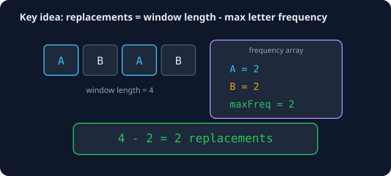

# 16. Longest Repeating Character Replacement

## 1. Problem Statement
Given an uppercase string and budget `k`, find the longest substring that can be made of one repeated letter by replacing at most `k` characters; `"ABAB", k=2` gives 4. Source tests include empty input and `k=0`; code indexes `A`–`Z`.

## 2. Pattern / Category
Sliding window + fixed frequency array.

## 3. Intuition
For a window of length `L`, replacing every character except its most frequent one costs `L-maxFreq`; the window is accepted when this is at most `k`.


## 4. Brute Force Approach
Check every substring, count its letters, and compute replacements needed: O(n²·26) time and O(26) extra space. This is a baseline, not the source code.

## 5. Optimal Approach (My Solution)
`freq[26]` tracks current-window counts. Each `right` step increments the corresponding uppercase letter count and updates `maxFreq`. While `(right-left+1)-maxFreq>k`, the code decrements the left character count and advances `left`; `maxFreq` is intentionally not recomputed after shrinking. `ans` records the largest window length.

Dry run for `"ABAB", k=2`: the window grows to length 4; `maxFreq=2`, so `4-2=2` replacements suffice and `ans=4`.



## 6. Code
```cpp
class Solution {
public:
    int characterReplacement(string s, int k) {
       int left = 0, right = 0, maxFreq = 0, ans = 0;
       int freq[26] = {0};
       for(;right<s.size();right++){
        char c =  s[right];
        freq[c-'A']++;
        maxFreq = max(maxFreq,freq[c-'A']);
        while((right-left+1) - maxFreq > k){
          freq[s[left]-'A']--;
          left++;
        }
        ans = max(ans,right-left+1);
       }
       return ans;
    }
};
```

## 7. Complexity Analysis
O(n) time and O(1) auxiliary space (26 counters).

## 8. Edge Cases
- Empty string returns 0.
- `k=0` permits only existing repeated-letter runs.
- The array index assumes characters are uppercase English letters `A`–`Z`.

## 9. Common Mistakes / Pitfalls
- Using `L-maxFreq` as valid without shrinking when it exceeds `k`.
- Decrementing the wrong character as the left edge moves.
- Assuming the stored `maxFreq` always equals the current window maximum; this implementation keeps a historical maximum to support its lazy-window method.

## 10. Key Takeaways
The replacement count is window size minus the largest letter frequency.

## 11. Related Problems
- Longest Substring Without Repeating Characters
- Permutation in a String
- Minimum Window Substring

## 12. 30-Second Interview Explanation
I count uppercase letters in a sliding window and track the largest frequency seen. The number of replacements needed is window length minus that frequency. If it exceeds `k`, I shrink from the left; otherwise I update `ans`. For `"ABAB"` with budget 2, two of each letter means all four characters can become the same.
