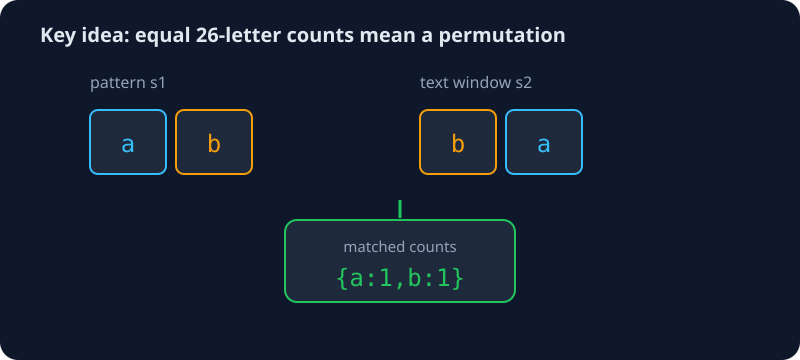

# 17. Permutation in String

## 1. Problem Statement
Return whether any substring of `s2` is a permutation of `s1`; `"ab"` occurs as `"ba"` in `"eidbaooo"`, so the answer is true. Source tests include empty strings; code assumes lowercase English letters.

## 2. Pattern / Category
Fixed-size sliding window + frequency arrays.

## 3. Intuition
A substring is a permutation exactly when its 26 character counts equal those of `s1`.


## 4. Brute Force Approach
Generate each length-`|s1|` substring and compare its character frequencies: O((m-n+1)·n) or O(26(m-n+1)) with counting, and O(26) space. This is a baseline.

## 5. Optimal Approach (My Solution)
If `s1` is longer, return false. `s1Map` receives the pattern counts and `s2Map` the first window. The loop `for(int j=0;i<s2.length();i++,j++)` adds `s2[i]`, removes `s2[j]`, and calls `match`; after the loop it calls `match` once more. `match` compares all 26 counts.

Dry run for `s1="ab", s2="eidbaooo"`: the initial `"ei"` window does not match; the sliding counts eventually represent `"ba"` at indices 3–4, whose `a` and `b` counts match, so the function returns true.



## 6. Code
```cpp
class Solution {
public:
    bool checkInclusion(string s1, string s2) {
      if(s1.length()>s2.length()) return false;
      int s1Map[26] = {0};
      int s2Map[26] = {0};
      int i;
      for(i=0; i<s1.length();i++){
        s1Map[s1[i]-'a']++;
        s2Map[s2[i]-'a']++;
      }
      for(int j=0;i<s2.length();i++,j++){
        s2Map[s2[i]-'a']++;
        s2Map[s2[j]-'a']--;
        if(match(s1Map,s2Map)){
          return true;
        }
      }
      return match(s1Map,s2Map);
    }
    bool match(int *s1, int *s2){
      for(int i=0; i<26; i++){
        if(s1[i]!=s2[i]){
          return false;
        }
      }
      return true;
    }
};
```

## 7. Complexity Analysis
With pattern length `n` and text length `m`, O(n + 26(m-n+1)) time, i.e. O(m) for the fixed 26 letters; O(1) auxiliary space.

## 8. Edge Cases
- `s1` longer than `s2` returns false.
- Both empty strings return true through the final `match`.
- Lowercase `a`–`z` is assumed by the array indexing.

## 9. Common Mistakes / Pitfalls
- Comparing only distinct letters instead of all frequencies.
- Sliding the window without removing its outgoing character.
- Checking windows of a different length than `s1`.

## 10. Key Takeaways
Frequency equality turns permutation detection into a constant-alphabet window check.

## 11. Related Problems
- Find All Anagrams in a String
- Minimum Window Substring
- Valid Anagram

## 12. 30-Second Interview Explanation
I count `s1` and the first same-length window in `s2` using two arrays. Then I slide by adding one character and removing the outgoing one, comparing all 26 counts with `match`. In the source test `"ab"` occurs as `"ba"` in `"eidbaooo"`, so it returns true.
