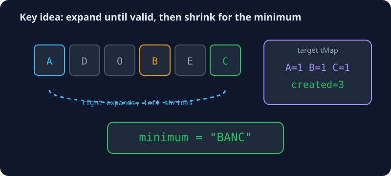

# 18. Minimum Window Substring

## 1. Problem Statement
Find the shortest substring of `s` containing every character of `t` with at least its multiplicity; `"ADOBECODEBANC","ABC"` gives `"BANC"`. Return empty if none exists. Source cases include repeated target letters and empty strings.

## 2. Pattern / Category
Variable sliding window + character frequency maps.

## 3. Intuition
Expand until every distinct target character has its required count, then shrink from the left while the window remains valid.


## 4. Brute Force Approach
Enumerate all substrings and compare their frequencies with `t`: O(|s|²·|Σ|) time and O(|Σ|) auxiliary space. This is a baseline, not the source implementation.

## 5. Optimal Approach (My Solution)
The early guard returns `""` when either string is empty or `s` is shorter. `tMap` counts target characters; `required=tMap.size()`. Each `r` adds `s[r]` to `sMap` and increments `created` only when a required character reaches its exact count. While `created==required`, the code records a shorter range in `ans`, removes `s[l]`, and lowers `created` if that removal makes a required count deficient. It returns `s.substr(ans[1],ans[0])`.

Dry run for `"ADOBECODEBANC","ABC"`: after collecting a valid range, left shrinking discards unnecessary prefix characters; the shortest recorded window is `"BANC"` (length 4).



## 6. Code
```cpp
class Solution
{
public:
  string minWindow(string s, string t)
  {
    if (s.length() < t.length() || s.length() == 0 || t.length() == 0)
    {
      return "";
    }
    unordered_map<char, int> tMap, sMap;
    for (char c : t)
    {
      tMap[c]++;
    }
    int required = tMap.size();
    int created = 0;
    int l = 0, r = 0;
    int ans[] = {-1, 0, 0};
    while (r < s.size())
    {
      char c = s[r];
      sMap[c]++;
      if (tMap.count(c) && sMap[c] == tMap[c])
      {
        created++;
      }
      while (created == required && l <= r)
      {
        int length = r - l + 1;
        if (ans[0] == -1 || ans[0] > length)
        {
          ans[0] = length;
          ans[1] = l;
          ans[2] = r;
        }
        char lc = s[l];
        sMap[lc]--;
        if (tMap.count(lc) && tMap[lc] > sMap[lc])
        {
          created--;
        }
        l++;
      }
      r++;
    }
    if(ans[0]==-1){
      return "";
    }
    return s.substr(ans[1],ans[0]);
  }
};
```

## 7. Complexity Analysis
Average O(|s|+|t|) time with unordered-map operations and O(|Σ|) space for the frequency maps, where `Σ` is the set of characters encountered.

## 8. Edge Cases
- Empty `s` or `t` returns `""`.
- No window containing all target counts leaves `ans[0]` at -1 and returns `""`.
- Repeated characters in `t` require the same multiplicity in the window.

## 9. Common Mistakes / Pitfalls
- Counting only distinct target characters but not enforcing their multiplicities.
- Shrinking before the window is valid.
- Reducing `created` for a non-required character.

## 10. Key Takeaways
`created` counts satisfied distinct character requirements, not total matched characters.

## 11. Related Problems
- Permutation in a String
- Find All Anagrams in a String
- Longest Repeating Character Replacement

## 12. 30-Second Interview Explanation
I count target frequencies, expand the right edge, and track how many distinct requirements are met in `created`. Once all `required` characters are satisfied, I save the current minimum and move the left edge until one needed count falls short. On the source example, this process records `"BANC"` as the shortest valid window.
