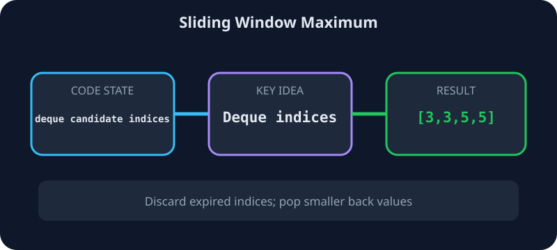

# 19. Sliding Window Maximum

## 1. Problem Statement
For every contiguous window of length `k`, return its maximum; `[1,3,-1,-3,5,3,6,7], k=3` gives `[3,3,5,5,6,7]`. Source tests cover duplicates, negatives, and `k=1`; code assumes `1<=k<=n`.

## 2. Pattern / Category
Sliding window + monotonic deque of indices.

## 3. Intuition
Discard indices outside the window and remove smaller values from the back because a newer larger value dominates them.


## 4. Brute Force Approach
Scan each window independently for its maximum: O((n-k+1)k) time and O(1) extra space beyond output. This baseline is not used by the source.

## 5. Optimal Approach (My Solution)
`indicesQueue` stores candidate indices. At each `r`, remove the front if it is before `l`; pop back indices while their values are strictly less than `nums[r]`; then push `r`. Once `r>=k-1`, write the front value to `result[r-k+1]` and increment `l`.

Dry run for `[1,3,-1,-3,5,3,6,7], k=3`: the first window has deque front at value 3, so result begins 3. When 5 arrives, smaller tail candidates are removed and the next completed window records 5.



## 6. Code
```cpp
class Solution {
public:
    vector<int> maxSlidingWindow(vector<int>& nums, int k) {
        int l = 0, r = 0;
        vector<int> result(nums.size()-k+1);
        deque<int> indicesQueue;
        while(r<nums.size()){
          if(indicesQueue.size()!=0 && l>indicesQueue.front()){
            indicesQueue.pop_front();
          }
          while (indicesQueue.size()!=0 && nums[indicesQueue.back()]<nums[r])
          {
            indicesQueue.pop_back();
          }
          indicesQueue.push_back(r);
          if(r>=k-1){
            result[r-k+1] = nums[indicesQueue.front()];
            l++;
          }
          r++;
        }
        return result;
    }
};
```

## 7. Complexity Analysis
O(n) time since each index is pushed and popped at most once; O(k) deque space, plus O(n-k+1) output space.

## 8. Edge Cases
- `k=1` returns the input values.
- `k=n` returns one maximum.
- The code assumes `1 <= k <= nums.size()`; it does not validate this before sizing `result`.

## 9. Common Mistakes / Pitfalls
- Store indices, not just values, so expired entries can be removed.
- Pop smaller candidates from the back before appending the new index.
- The code retains equal values (`<`, not `<=`); this is still correct.

## 10. Key Takeaways
The deque front is always the maximum candidate for the current window.

## 11. Related Problems
- Daily Temperatures
- Largest Rectangle in Histogram
- Shortest Subarray with Sum at Least K

## 12. 30-Second Interview Explanation
I keep indices in a deque with values in nonincreasing order. Before adding index `r`, I expire the front if it is left of the window and remove smaller values from the back. Once a full window exists, the front value is its maximum. The first source window `[1,3,-1]` reports 3.
