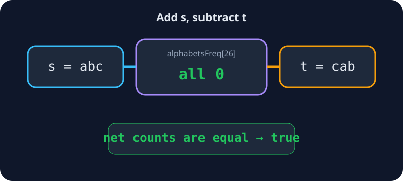

# 2. Valid Anagram

## 1. Problem Statement
- Given two strings, determine whether they contain exactly the same characters with the same counts.
- Example: `"anagram" -> "nagaram"` is `true`; `"rat" -> "car"` is `false`
- Constraints: The code assumes lowercase English letters and uses a fixed array of 26 frequencies.

## 2. Pattern / Category
- Hash Map / Frequency Array
- Counting character occurrences in each string makes anagram comparison straightforward.

## 3. Intuition
- Same length alone is not enough because character identities must match.
- For one string, increment a character count; for the other, decrement the same count, then verify that every count is zero.



## 4. Brute Force Approach
- Sort both strings and compare the sorted results.
- Time: O(n log n); Space: O(n) for the sorted copies or implementation-dependent sorting storage.
- Sorting is more work than directly counting the 26 possible letters.

## 5. Optimal Approach (My Solution)
1. If `s.length()` differs from `t.length()`, return `false`.
2. Create `alphabetsFreq[26]`, initialized to zero.
3. Loop through both strings by index.
4. Increment the count for `s[i]` and decrement it for `t[i]`.
5. Scan all frequency entries; any nonzero value means the counts differ.
6. Return `true` if every entry is zero.
- `alphabetsFreq`: balances character frequencies; `length`: shared string length; `i`: current index.

Dry run for `"abc"` and `"cab"`:

| i | s[i] | t[i] | Count balance |
|---|---|---|---|
| 0 | a | c | a +1, c -1 |
| 1 | b | a | b +1, a 0 |
| 2 | c | b | c 0, b 0 |

All entries are zero, so the strings are anagrams.



## 6. Code
```cpp
class Solution {
public:
    bool isAnagram(string s, string t) {
        if (s.length() != t.length()) { // Length mismatch cannot be an anagram
            return false;
        }

        int alphabetsFreq[26] = {0};
        int length = s.length();
        for (int i = 0; i < length; i++) {
            alphabetsFreq[s[i] - 'a']++; // Count a character in s
            alphabetsFreq[t[i] - 'a']--; // Remove a character for t
        }

        for (int n : alphabetsFreq) {
            if (n != 0) { // Counts do not balance
                return false;
            }
        }
        return true;
    }
};
```

## 7. Complexity Analysis
- Time complexity: O(n), where `n` is the shared string length.
- Space complexity: O(1), because the frequency array always has 26 entries.

## 8. Edge Cases
- Empty strings: lengths match and all zero frequencies remain; returns `true`.
- Equal strings: each character increments and decrements to zero.
- Different lengths: returns `false` before counting.
- A repeated character: net changes must still balance across both strings.

## 9. Common Mistakes / Pitfalls
- Skipping the length check and allowing strings of different lengths to appear balanced accidentally.
- Using the wrong character index because the code assumes lowercase letters.
- Returning before checking every frequency entry.

## 10. Key Takeaways
- Net character counts reveal whether two strings are anagrams.
- Increment for the first string and decrement for the second.
- Check both lengths and every remaining frequency.

## 11. Related Problems
- Contains Duplicate
- Group Anagrams
- First Unique Character in a String

## 12. 30-Second Interview Explanation
I first check whether the two strings have the same length. Then I use a 26-element frequency array for lowercase letters. While scanning both strings together, I increment for a character in `s` and decrement for the corresponding character in `t`. At the end, a zero in every array position means every character has the same count.
