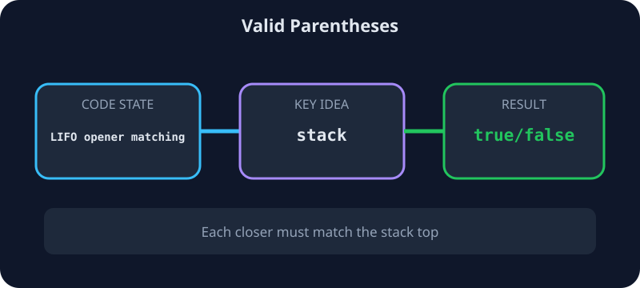

# 20. Valid Parentheses

## 1. Problem Statement
Determine whether brackets in a string are correctly matched and nested; `"([])"` is true while `"([)]"` is false. Source tests cover all three bracket kinds and the empty string; the intended input alphabet is `()[]{}`.

## 2. Pattern / Category
Stack of opening brackets.

## 3. Intuition
Each closing bracket must match the most recent unclosed opener, so use LIFO order.


## 4. Brute Force Approach
Repeatedly remove adjacent matched pairs until no more can be removed, then check whether the string is empty; this can take O(n²) time and O(n) space. It is not the source implementation.

## 5. Optimal Approach (My Solution)
`parenthesesPairs` maps each closer to its opener. The loop treats any character not in that map as an opener and pushes it. For a closer, it returns false if the stack is empty or its top differs; otherwise it pops. Final validity is `parenthesesStack.empty()`.

Dry run for `"([)]"`: `(` and `[` are pushed; `)` expects `(` but the top is `[`, so the function returns false.



## 6. Code
```cpp
class Solution {
public:
    bool isValid(string s) {
      unordered_map<char,char> parenthesesPairs;
      parenthesesPairs.insert({'}','{'});
      parenthesesPairs.insert({')','('});
      parenthesesPairs.insert({']','['});
      stack<char> parenthesesStack;
      for(char c: s){
        if(parenthesesPairs.find(c)!=parenthesesPairs.end()){
          if(parenthesesStack.empty()){
            return false;
          }
          char topElement = parenthesesStack.top();
          if(parenthesesPairs[c]!=topElement){
            return false;
          }
          parenthesesStack.pop();
        } else{
          parenthesesStack.push(c);
        }
      }
      return parenthesesStack.empty();
    }
};
```

## 7. Complexity Analysis
O(n) time and O(n) stack space; each character is pushed or popped at most once. The three-entry map is constant-sized.

## 8. Edge Cases
- Empty input returns true.
- A leading closer or leftover opener returns false.
- The intended alphabet is `()[]{}`. Other characters are treated as opening brackets by this code.

## 9. Common Mistakes / Pitfalls
- Checking only counts, which misses incorrect nesting such as `"([)]"`.
- Popping without first checking for an empty stack.
- Treating every non-closing input character as a valid opener outside the stated alphabet.

## 10. Key Takeaways
The top of a stack enforces properly nested bracket order.

## 11. Related Problems
- Min Stack
- Evaluate Reverse Polish Notation
- Decode String

## 12. 30-Second Interview Explanation
I map each closing bracket to its expected opener and scan the string. Openers go on `parenthesesStack`; a closer must match its top, which is then popped. At the end, the stack must be empty. In the source example `"([)]"`, `)` mismatches the top `[`, so it returns false.
