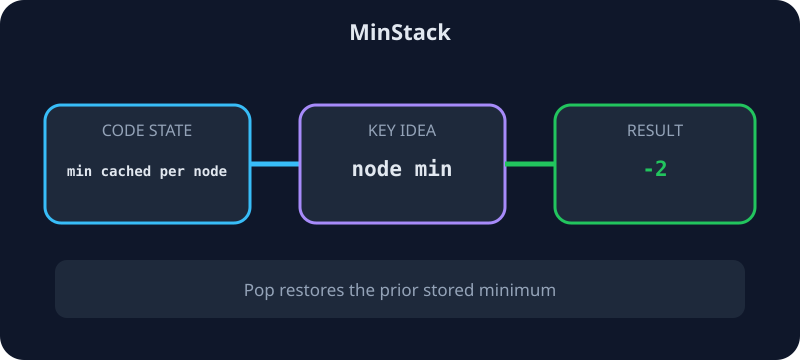

# 21. Min Stack

## 1. Problem Statement
Implement a stack supporting `push`, `pop`, `top`, and `getMin`; after pushing `-2,0,-3`, `getMin()` is `-3`, and after one pop it is `-2`. Source sequences include repeated minima; access operations assume a nonempty stack.

## 2. Pattern / Category
Linked stack with a cached minimum per node.

## 3. Intuition
Store alongside each value the minimum at that node and below, so removing the top automatically restores the prior minimum.


## 4. Brute Force Approach
Keep values in a normal stack and scan it on every `getMin`: O(n) per minimum query, O(1) push/pop, O(n) space. This is a baseline, not the code here.

## 5. Optimal Approach (My Solution)
`head` points to the newest `Node`; each node holds `val`, `min`, and `next`. `push` creates a node whose `min` is either the new value or the old head's minimum. `pop` deletes the head and advances it; `top` and `getMin` read the head fields.

Dry run from source test 1: push `-2`, `0`, `-3`; the top node stores minimum `-3`. After `pop`, head is the `0` node, whose stored minimum is `-2`.



## 6. Code
```cpp
class Node{
  public:
  int val, min;
  Node* next;
  Node(int val, int min, Node *next){
    this->val = val;
    this->min = min;
    this-> next = next;
  }
};

class MinStack {
    Node* head;
public:
    MinStack() {
        head = NULL;
    }
    void push(int value) {
      if(head==NULL){
        head = new Node(value,value,NULL);
      }
      else{
        int min = head->min > value ? value : head->min;
        head = new Node(value,min,head);
      }
    }
    void pop() {
       Node* temp = head;
       head = head->next;
       delete temp;
    }
    int top() {
      return head->val;
    }
    int getMin() {
     return head->min;
    }
};
```

## 7. Complexity Analysis
`push`, `pop`, `top`, and `getMin` are O(1). Space is O(n) for one linked node per pushed value.

## 8. Edge Cases
- Repeated minima remain correct because each node stores its own prefix minimum.
- The methods `pop`, `top`, and `getMin` assume the stack is nonempty; no empty guard is present.
- The source test includes negative values.

## 9. Common Mistakes / Pitfalls
- Updating one global minimum without saving what it was before a pop.
- Forgetting to delete the popped node.
- Calling accessors or `pop` on an empty stack.

## 10. Key Takeaways
Per-node cached state makes minimum retrieval constant time and naturally rolls back on pop.

## 11. Related Problems
- Valid Parentheses
- Implement Queue using Stacks
- Design a Stack With Increment Operation

## 12. 30-Second Interview Explanation
Each linked-list node stores its value and the minimum from that node down. On push, I compare the new value with the current head minimum; on pop I move the head back to the prior node. Thus `top` and `getMin` just read the head in O(1). Popping `-3` from the source sequence restores minimum `-2`.
