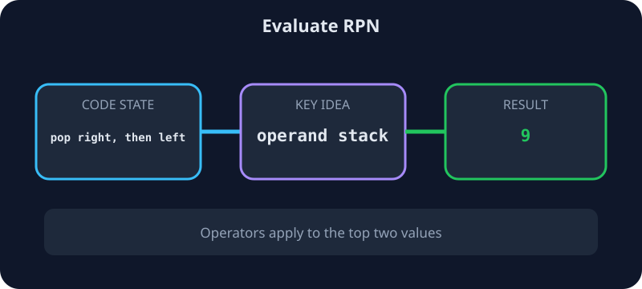

# 22. Evaluate Reverse Polish Notation

## 1. Problem Statement
Evaluate a valid arithmetic expression whose operators follow their operands; `["2","1","+","3","*"]` gives 9. Source tests include negative numbers and integer division; expressions are assumed valid.

## 2. Pattern / Category
Stack-based expression evaluation.

## 3. Intuition
An operator applies to the two most recent unfinished values, so pop the top two operands and push the result.


## 4. Brute Force Approach
Parse the tokens into an expression tree and recursively evaluate it: O(n) time and O(n) space. This is a baseline alternative; the source directly uses a stack.

## 5. Optimal Approach (My Solution)
For each token `c`, push `stoi(c)` if it is not an operator. For operators, pop into `a` (top/right operand) and then `b` (left operand); push `a+b`, `b-a`, `a*b`, or `b/a`. Return `numbersStack.top()`.

Dry run from `["4","13","5","/","+"]`: push 4, 13, 5; `/` pops `a=5,b=13` and pushes `13/5=2` (integer truncation); `+` combines 4 and 2, returning 6.



## 6. Code
```cpp
class Solution {
public:
    int evalRPN(vector<string>& tokens) {
      stack<int> numbersStack;
      int a = 0, b = 0;
      for(int i=0; i<tokens.size();i++){
        string c = tokens[i];
        a = 0, b = 0;
        if (c=="+"){
          a = numbersStack.top();
          numbersStack.pop();
          b = numbersStack.top();
          numbersStack.pop();
          numbersStack.push((a+b));
        } else if(c=="-"){
          a = numbersStack.top();
          numbersStack.pop();
          b = numbersStack.top();
          numbersStack.pop();
          numbersStack.push((b-a));
        } else if(c=="*"){
          a = numbersStack.top();
          numbersStack.pop();
          b = numbersStack.top();
          numbersStack.pop();
          numbersStack.push((a*b));
        } else if(c=="/"){
          a = numbersStack.top();
          numbersStack.pop();
          b = numbersStack.top();
          numbersStack.pop();
          numbersStack.push((b/a));
        } else{
          numbersStack.push(stoi(c));
        }
      }
      return numbersStack.top();
    }
};
```

## 7. Complexity Analysis
O(n) time and O(n) stack space for `n` tokens.

## 8. Edge Cases
- Subtraction and division are order-sensitive; `b` is the earlier operand.
- Division uses C++ integer division, truncating toward zero.
- The code assumes a valid expression with enough operands and no division by zero.

## 9. Common Mistakes / Pitfalls
- Reversing `a-b` or `a/b`.
- Treating a negative number token such as `"-11"` as the subtraction operator.
- Returning before the final stack value is computed.

## 10. Key Takeaways
In postfix notation, operators consume the two most recent stack values.

## 11. Related Problems
- Basic Calculator
- Valid Parentheses
- Decode String

## 12. 30-Second Interview Explanation
I scan tokens, pushing numbers. At an operator I pop the right operand into `a`, then the left into `b`, apply the operation in the correct order, and push the result. For the source tokens `4 13 5 / +`, integer `13/5` is 2, then `4+2` returns 6.
