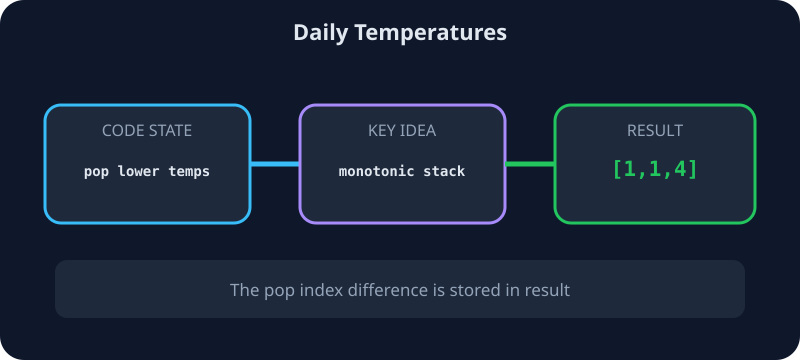

# 23. Daily Temperatures

## 1. Problem Statement
For each day, report how many days until a strictly warmer temperature, or 0 if none follows; `[73,74,75,71,69,72,76,73]` gives `[1,1,4,2,1,1,0,0]`. Tests include equal temperatures.

## 2. Pattern / Category
Monotonic decreasing stack of temperature/index pairs.

## 3. Intuition
When today's temperature is warmer, it resolves every earlier unresolved cooler day at the top of the stack.


## 4. Brute Force Approach
For each day, scan forward until finding a warmer temperature: O(n²) time and O(n) output space. This baseline is not the source method.

## 5. Optimal Approach (My Solution)
`result` is initialized to zero. `mStack` stores `{temperature,index}`. At each `i`, while the top temperature is strictly less than `temperatures[i]`, the code writes the index difference into that day and pops; then it pushes `{c,i}`. Unresolved days keep zero.

Dry run for `[73,74,75,71,69,72,76,73]`: 74 resolves 73 after 1 day; 75 resolves 74 after 1; 72 resolves 71 after 2 and 69 after 1; 76 resolves 75 after 4 and 72 after 1.



## 6. Code
```cpp
class Solution {
public:
    vector<int> dailyTemperatures(vector<int>& temperatures) {
        vector<int> result(temperatures.size(),0);
        stack<pair<int,int>> mStack;
        for(int i=0; i<temperatures.size(); i++){
            int c = temperatures[i];
            while(mStack.size()!=0 && mStack.top().first<c){
                int jumps = i-mStack.top().second;
                result[mStack.top().second] = jumps;
                mStack.pop();
            }
            pair<int,int> tempDetails = {c,i};
            mStack.push(tempDetails);
        }
        return result;
    }
};
```

## 7. Complexity Analysis
O(n) time because each pair is pushed and popped once; O(n) stack space plus O(n) result space.

## 8. Edge Cases
- Empty input returns an empty vector.
- Equal temperatures do not resolve one another because the comparison is strict `<`.
- The final non-increasing suffix remains zero.

## 9. Common Mistakes / Pitfalls
- Resolving on equal temperatures rather than strictly warmer ones.
- Storing temperatures without indices, which are needed for the distance.
- Initializing results to an unspecified value instead of zero.

## 10. Key Takeaways
The stack holds unresolved days in non-increasing temperature order.

## 11. Related Problems
- Next Greater Element
- Online Stock Span
- Sliding Window Maximum

## 12. 30-Second Interview Explanation
I initialize all answers to zero and keep unresolved `{temperature,index}` pairs on a stack. A warmer current day pops and resolves every cooler top, storing the day difference. In the source test, 76 at index 6 resolves 75 at index 2 after four days.
