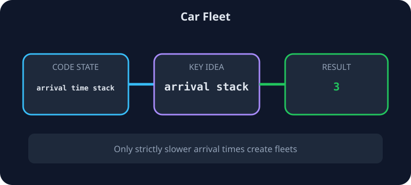

# 24. Car Fleet

## 1. Problem Statement
Given a target and cars' starting positions and speeds, count fleets reaching the target; target 12 with positions `[10,8,0,5,3]` and speeds `[2,4,1,1,3]` gives 3. Cars that catch a slower car travel together; source tests include one car.

## 2. Pattern / Category
Sort by position + monotonic stack of arrival times.

## 3. Intuition
Process cars from nearest target to farthest. A car that arrives no later than the fleet ahead catches it and does not create a new fleet.


## 4. Brute Force Approach
Simulate positions over time and merge cars when they meet: potentially O(n²) event processing and O(n) extra space. The source uses arrival-time comparisons instead.

## 5. Optimal Approach (My Solution)
The code pairs each `position[i]` with `speed[i]`, sorts pairs in descending order, and computes `(target-position)/double(speed)` for each. `timeStack` receives the time only if it is empty or the new `arrivalTime` is greater than its top; its size is returned.

Dry run from `{target=12, positions=[10,8,0,5,3], speeds=[2,4,1,1,3]}`: descending positions give arrivals 1, 1, 7, 3, 12. The second car's time 1 joins the first; time 7 creates a fleet, time 3 joins it, and time 12 creates a third, for count 3.



## 6. Code
```cpp
class Solution {
public:
    int carFleet(int target, vector<int>& position, vector<int>& speed) {
        vector<pair<int,int>> speedAndPositionPairs;
        int length = position.size();
        for(int i=0; i<length; i++){
            speedAndPositionPairs.push_back({position[i],speed[i]});
        }
        sort(speedAndPositionPairs.rbegin(), speedAndPositionPairs.rend());
        stack<double> timeStack;
        for(auto car: speedAndPositionPairs){
            double arrivalTime = (target-car.first)/double(car.second);
            if (timeStack.empty() || arrivalTime>timeStack.top()){
                timeStack.push(arrivalTime);
            }
        }
        return timeStack.size();
    }
};
```

## 7. Complexity Analysis
O(n log n) time for sorting and O(n) space for pairs and the arrival-time stack.

## 8. Edge Cases
- No cars returns 0.
- A single car is one fleet.
- Equal arrival time joins the fleet ahead because the comparison is strict `>`.

## 9. Common Mistakes / Pitfalls
- Processing cars from farthest to nearest.
- Using integer division for arrival time; the source casts speed to `double`.
- Counting a car with equal arrival time as a new fleet.

## 10. Key Takeaways
Descending positions convert catching behavior into comparing arrival times against the fleet ahead.

## 11. Related Problems
- Daily Temperatures
- Largest Rectangle in Histogram
- Meeting Rooms

## 12. 30-Second Interview Explanation
I sort cars from closest to the target backward and compute each arrival time. A car creates a fleet only if it arrives later than the fleet immediately ahead; otherwise it catches that fleet. In the source example, the car at position 8 has the same time as the car at 10 and joins it, while later larger times add fleets, yielding 3.
