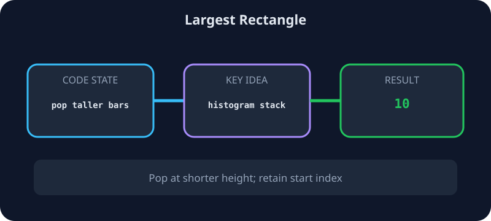

# 25. Largest Rectangle in Histogram

## 1. Problem Statement
Given nonnegative histogram heights, find the largest rectangle over adjacent bars; `[2,1,5,6,2,3]` gives area 10. Source cases include equal/zero heights and empty input.

## 2. Pattern / Category
Monotonic stack of start indices and heights.

## 3. Intuition
When a shorter bar arrives, taller bars can no longer extend farther right; pop them and calculate their maximal width.


## 4. Brute Force Approach
For every interval, track its minimum height and calculate area: O(n²) time and O(1) extra space. It is only a baseline.

## 5. Optimal Approach (My Solution)
For each `h`, `start=i`. While the stack top height is greater than `h`, pop `{index,height}`, calculate `height*(i-index)`, and carry its `index` into `start`. Push `{start,h}`. After scanning, pop the remaining entries and use width `length-index`.

Dry run for `[2,1,5,6,2,3]`: when 2 at index 4 arrives, the 6 and 5 bars are popped; the 5 bar spans indices 2–3, area `5*2=10`, which is retained as the maximum.



## 6. Code
```cpp
class Solution {
public:
    int largestRectangleArea(vector<int>& heights) {
        stack<pair<int,int>> mStack;
        int length = heights.size();
        int maxArea = 0;
        for(int i=0; i<length; i++){
            int h = heights[i];
            int start = i;
            while (mStack.size()>0 && mStack.top().second>h){
                int index = mStack.top().first;
                int height = mStack.top().second;
                mStack.pop();
                maxArea = max(maxArea, height * (i-index));
                start = index;
            }
            mStack.push({start,h});
        }
        while(mStack.size()>0){
            int index = mStack.top().first;
            int h = mStack.top().second;
            mStack.pop();
            maxArea = max(maxArea,h*(length-index));
        }
        return maxArea;
    }
};
```

## 7. Complexity Analysis
O(n) time, since each stack entry is pushed and popped once; O(n) stack space.

## 8. Edge Cases
- Empty input returns 0.
- Equal heights are not popped (`>` only); multiple equal entries can remain and still yield the correct area.
- A zero-height bar closes positive-height spans.

## 9. Common Mistakes / Pitfalls
- Forgetting to preserve the earliest popped `index` in `start`.
- Using `>=` changes the stack behavior; this code uses strict `>`.
- Omitting the final pass for rectangles reaching the array end.

## 10. Key Takeaways
Each popped bar is evaluated when its first shorter right boundary is found.

## 11. Related Problems
- Trapping Rain Water
- Daily Temperatures
- Maximal Rectangle

## 12. 30-Second Interview Explanation
I keep bars with their earliest start index in a stack. A shorter height pops taller entries and lets me compute their largest possible rectangle ending just before the current index; I propagate the popped start to the new bar. A final pop pass handles bars extending to the end. In `[2,1,5,6,2,3]`, heights 5 and 6 give area 10.
