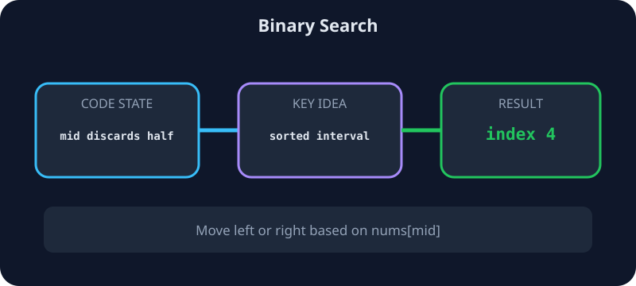

# 26. Binary Search

## 1. Problem Statement
Find `target` in an ascending sorted integer array and return its index, or `-1` if absent; target 9 in `[-1,0,3,5,9,12]` returns 4. Source tests include negative and singleton arrays.

## 2. Pattern / Category
Iterative binary search.

## 3. Intuition
Compare the middle value with the target and discard the half that cannot contain it.


## 4. Brute Force Approach
Scan every element: O(n) time and O(1) extra space. This is a baseline, not the source solution.

## 5. Optimal Approach (My Solution)
`left=0`, `right=nums.size()-1`; while `left<=right`, compute overflow-safe midpoint `left+(right-left)/2`. If target is greater, set `left=mid+1`; if smaller, set `right=mid-1`; otherwise return `mid`. If the interval empties, return `-1`.

Dry run for `[-1,0,3,5,9,12]`, target 9: middle index 2 has value 3, so move left to 3; next midpoint index 4 is 9, so return 4.



## 6. Code
```cpp
class Solution {
public:
    int search(vector<int>& nums, int target) {
        int left = 0, right = nums.size() - 1;
        while (left <= right) {
            int mid = left + (right - left) / 2;
            if (target > nums[mid]) {
                left = mid + 1;
            }
            else if (target < nums[mid]) {
                right = mid - 1;
            }
            else {
                return mid;
            }
        }
        return -1;
    }
};
```

## 7. Complexity Analysis
O(log n) time and O(1) auxiliary space.

## 8. Edge Cases
- Empty input returns `-1` on typical implementations.
- A one-element array returns 0 only when it matches.
- Input must be sorted in ascending order for the direction decisions to work.

## 9. Common Mistakes / Pitfalls
- Using `left<right` and missing the last candidate.
- Failing to move past `mid`, causing an infinite loop.
- Computing midpoint as `(left+right)/2`, which can overflow for large indices.

## 10. Key Takeaways
Maintain a closed search interval and reduce it by roughly half on each comparison.

## 11. Related Problems
- Search in Rotated Sorted Array
- Search a 2D Matrix
- Koko Eating Bananas

## 12. 30-Second Interview Explanation
I maintain inclusive `left` and `right` bounds. Each iteration checks the midpoint, returns if it matches, or discards the half indicated by the sorted order. The source example finds 9 at index 4 after first discarding values through index 2.
