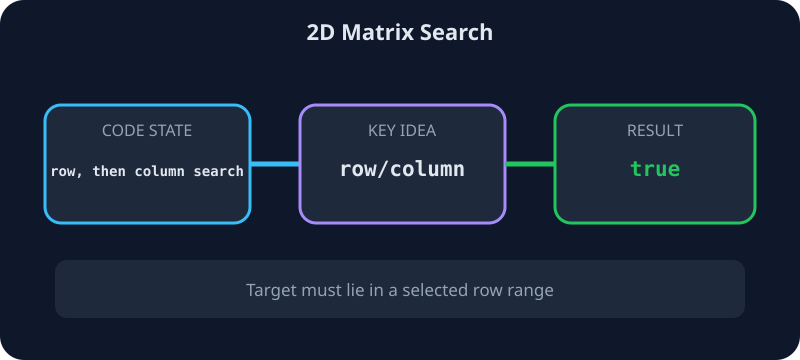

# 27. Search a 2D Matrix

## 1. Problem Statement
Search a matrix with sorted rows and each row's first value greater than the previous row's last; target 3 is present in `[[1,3,5,7],[10,11,16,20],[23,30,34,60]]`. Source tests include one-cell matrices; empty matrices are not supported by the code.

## 2. Pattern / Category
Two-stage binary search.

## 3. Intuition
First identify the only row whose endpoint range may contain the target, then binary-search that row.


## 4. Brute Force Approach
Inspect every cell: O(mn) time and O(1) extra space. This is a baseline, not the source code.

## 5. Optimal Approach (My Solution)
`COL` is the final column; `top` and `bot` bound possible rows. Each row midpoint `ROW` is excluded if target is below its first value or above its last. If no row range remains, return false. Then `l/r` binary-search the selected row and return true on equality.

Dry run for the source matrix `[[1,3,5,7],[10,11,16,20],[23,30,34,60]]`, target 3: row-range search selects row 0; the second binary search finds 3 and returns true.



## 6. Code
```cpp
class Solution {
public:
    bool searchMatrix(vector<vector<int>>& matrix, int target) {
        int COL = matrix[0].size()-1;
        int top = 0, bot = matrix.size()-1;
        int ROW = 0;
        while(top<=bot){
            ROW = top+(bot-top)/2;
            if(target<matrix[ROW][0]){
                bot = ROW - 1;
            } else if (target>matrix[ROW][COL]){
                top = ROW + 1;
            } else{
                break;
            }
        }
        if(top>bot) return false;
        int l = 0, r = COL;
        int m = 0;
        while(l<=r){
            m = l+(r-l)/2;
            if(target>matrix[ROW][m]){
                l = m + 1;
            } else if(target<matrix[ROW][m]){
                r = m - 1;
            } else{
                return true;
            }
        }
        return false;
    }
};
```

## 7. Complexity Analysis
O(log m + log n) time and O(1) extra space for an m×n matrix.

## 8. Edge Cases
- A target outside every row's endpoints returns false.
- One-row and one-cell matrices work.
- The source accesses `matrix[0]` without checking for an empty matrix; it assumes a nonempty rectangular matrix with nonempty rows.

## 9. Common Mistakes / Pitfalls
- Using this method when rows are sorted individually but not globally ordered.
- Searching the wrong row after comparing endpoints.
- Forgetting the empty-matrix precondition.

## 10. Key Takeaways
The matrix ordering allows row selection and in-row search to be done independently.

## 11. Related Problems
- Binary Search
- Search a 2D Matrix II
- Search in Rotated Sorted Array

## 12. 30-Second Interview Explanation
I binary-search row ranges using each row's first and last values. Once a candidate row is found, I run an ordinary binary search across its columns. For the source target 3, the row search selects the first row and the in-row search finds it.
