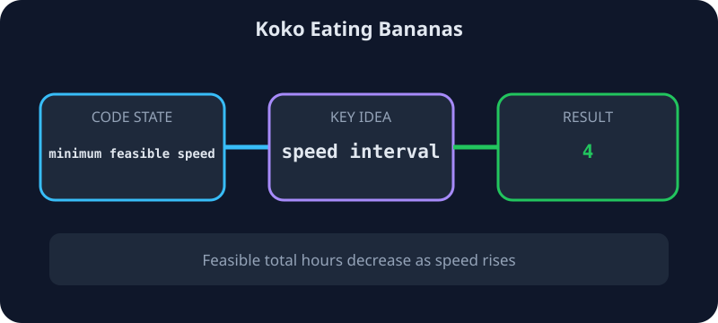

# 28. Koko Eating Bananas

## 1. Problem Statement
Find the minimum integer eating speed `k` that finishes all piles within `h` hours; `[3,6,7,11], h=8` gives 4. Source cases include one pile and large values; piles are assumed nonempty and positive.

## 2. Pattern / Category
Binary search on a monotonic answer.

## 3. Intuition
As speed increases, required hours never increase, so binary-search the smallest feasible speed.


## 4. Brute Force Approach
Try each speed from 1 through the largest pile and count hours: O(n·M) time, where `M=max(piles)`, and O(1) extra space. This is a baseline, not the source solution.

## 5. Optimal Approach (My Solution)
Bounds are `l=1` and `r=max_element(piles)`; `res` starts at `r`. For midpoint `k`, the code sums `ceil(p/double(k))` for every pile. If total hours are within `h`, it saves the smaller speed and searches left; otherwise it searches right.

Dry run for `[3,6,7,11], h=8`: speed 6 needs `1+1+2+2=6` hours, so it is feasible and search continues left; speed 4 needs `1+2+2+3=8`, so the minimum is 4.



## 6. Code
```cpp
class Solution { 
public: 
    int minEatingSpeed(vector<int>& piles, int h) { 
        int k = 0;
        int l = 1, r = *max_element(piles.begin(),piles.end()); 
        int res = r; 
        while (l<=r){ 
            k = (l+r)/2; 
            double total = 0; 
            for(int p: piles){ 
                total+= ceil(p/double(k)); 
            } 
            if(total<=h){ 
                res = min(res,k); 
                r = k-1; 
            } else{ 
                l = k+1; 
            } 
        } 
        return res; 
    } 
};
```

## 7. Complexity Analysis
O(n log M) time and O(1) extra space, with `M` the largest pile. The feasibility scan is O(n) per binary-search step.

## 8. Edge Cases
- A single pile with `h` greater than its size can use speed 1.
- Speed is bounded above by the largest pile.
- The code assumes `piles` is nonempty and pile sizes are positive.

## 9. Common Mistakes / Pitfalls
- Summing `p/k` with integer division instead of rounding each pile's hours up.
- Searching for any feasible speed rather than continuing left to find the minimum.
- Setting the lower bound above 1.

## 10. Key Takeaways
Binary-search the smallest speed satisfying a monotonic feasibility condition.

## 11. Related Problems
- Minimum in Rotated Sorted Array
- Capacity To Ship Packages Within D Days
- Split Array Largest Sum

## 12. 30-Second Interview Explanation
I binary-search speeds from 1 to the largest pile. At each midpoint I sum the ceiling of each pile divided by the speed. If total hours fit, I save that speed and search lower; otherwise I search higher. For `[3,6,7,11]` in 8 hours, speed 4 uses exactly 8 hours and is minimal.
