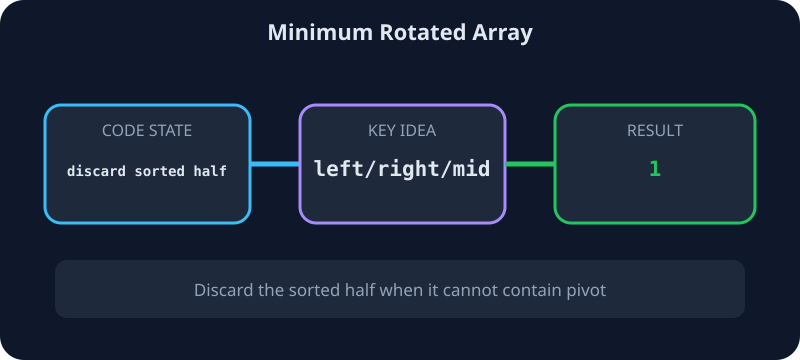

# 29. Find Minimum in Rotated Sorted Array

## 1. Problem Statement
Find the minimum value in a rotated ascending array; `[3,4,5,1,2]` gives 1. Source tests include already sorted and single-element arrays; the code assumes nonempty input with distinct values.

## 2. Pattern / Category
Binary search in a rotated sorted array.

## 3. Intuition
If the current interval is already sorted, its leftmost value is its minimum; otherwise use the midpoint to select the unsorted side that may contain the pivot.


## 4. Brute Force Approach
Scan all values and track the minimum: O(n) time and O(1) extra space. This baseline is not the source method.

## 5. Optimal Approach (My Solution)
`res` starts at `nums[l]`. While `l<=r`, if `nums[l]<nums[r]`, update `res` with `nums[l]` and stop. Otherwise compute `m`, update `res` with `nums[m]`, then move `l=m+1` when `nums[m]>=nums[l]`, else move `r=m-1`.

Dry run for `[3,4,5,1,2]`: endpoints are out of sorted order; midpoint value 5 is considered and the left sorted portion is discarded. The next interval includes 1, which becomes `res`; the remaining sorted interval terminates with minimum 1.



## 6. Code
```cpp
class Solution {
public:
    int findMin(vector<int>& nums) {
        int l = 0, r = nums.size()-1;
        int res = nums[l];
        int m = 0;
        while(l<=r){
            if(nums[l]<nums[r]){
                res = min(res,nums[l]);
                break;
            }
            m = (l+r)/2;
            res = min(res,nums[m]);
            if(nums[m]>=nums[l]){
                l = m+1;
            } else {
                r=m-1;
            }
        }
        return res;
    }
};
```

## 7. Complexity Analysis
O(log n) time and O(1) extra space for the usual distinct-value input.

## 8. Edge Cases
- A sorted array returns its first value.
- A one-element array returns that element.
- The implementation assumes nonempty input and distinct values; duplicate values can weaken its branch decision.

## 9. Common Mistakes / Pitfalls
- Returning the midpoint without considering the other half.
- Forgetting the already-sorted interval check.
- Applying the distinct-value branch rule unchanged when duplicates are allowed.

## 10. Key Takeaways
The pivot divides the array into sorted portions; binary search narrows toward the rotation boundary.

## 11. Related Problems
- Search in Rotated Sorted Array
- Binary Search
- Find Peak Element

## 12. 30-Second Interview Explanation
I keep a candidate minimum in `res`. If the active endpoints are sorted, the left endpoint is the minimum and I stop. Otherwise I inspect the midpoint and discard the sorted left portion or the right portion based on its relation to `nums[l]`. The source array `[3,4,5,1,2]` returns 1.
