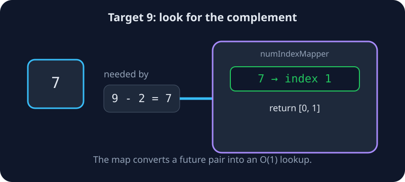

# 3. Two Sum

## 1. Problem Statement
- Given an integer array and a target, find two indices whose values add to the target.
- Example: `[2, 7, 11, 15]`, target `9 -> [0, 1]`; `[3, 3]`, target `6 -> [0, 1]`
- Constraints: The code assumes at least one pair exists or returns an empty vector if no pair is found.

## 2. Pattern / Category
- Hash Map
- A map stores each value with its index so the needed complement can be found quickly.

## 3. Intuition
- For the current number, only one partner can complete the target: `target - current`.
- Store previously seen numbers in a map, then check whether the current complement was seen before.



## 4. Brute Force Approach
- Try every pair of indices and check whether their values sum to the target.
- Time: O(n^2); Space: O(1).
- It tests many pairs even though each needed complement can be located directly.

## 5. Optimal Approach (My Solution)
1. Create `numIndexMapper` to map a value to its index.
2. Set `complement` to `0`.
3. Scan `nums` from left to right.
4. Calculate `complement = target - nums[i]`.
5. If the complement is already in the map, return both its stored index and `i`.
6. Otherwise store `nums[i]` with index `i`.
7. Return an empty vector if no pair is found.
- `numIndexMapper`: previously seen value-to-index map; `complement`: value needed from a prior element; `i`: current index.

Dry run for `[2, 7, 11, 15]`, target `9`:

| i | nums[i] | Complement | Map before | Action |
|---|---|---|---|---|
| 0 | 2 | 7 | `{}` | Store `2 -> 0` |
| 1 | 7 | 2 | `{2 -> 0}` | Return `[0, 1]` |



## 6. Code
```cpp
class Solution {
public:
    vector<int> twoSum(vector<int>& nums, int target) {
        unordered_map<int, int> numIndexMapper;
        int complement = 0;
        int n = nums.size();

        for (int i = 0; i < n; i++) {
            complement = target - nums[i];
            if (numIndexMapper.find(complement) != numIndexMapper.end()) {
                // Return the prior complement index and the current index
                return {numIndexMapper[complement], i};
            }
            numIndexMapper[nums[i]] = i; // Store the current value and index
        }
        return {}; // No pair found
    }
};
```

## 7. Complexity Analysis
- Time complexity: O(n) on average, because each value requires one map lookup and one possible insertion.
- Space complexity: O(n), because the map can store all previous values.

## 8. Edge Cases
- Duplicate values: `[3, 3]`, target `6` finds the second element after storing the first.
- Negative numbers: complements are calculated normally, such as `-8 - (-3) = -5`.
- Zero values: the map and complement logic handle them like other integers.
- No pair: the loop ends and returns `{}`.

## 9. Common Mistakes / Pitfalls
- Checking the complement after overwriting or inserting the current value, which could reuse the same index.
- Returning `{i, i}` or otherwise using the current index twice.
- Forgetting the no-solution return value.

## 10. Key Takeaways
- Convert the pair question into a complement lookup.
- Store values as they are scanned, before looking for the next matching value.
- One pass is enough when the map stores prior indices.

## 11. Related Problems
- Contains Duplicate
- Valid Anagram
- 3Sum

## 12. 30-Second Interview Explanation
I scan the array once and store every value with its index in a hash map. For each number, I calculate the complement needed to reach the target. If the complement is already in the map, I return its index and the current index. Otherwise, I store the current number and continue. This avoids checking every pair and runs in average linear time.
