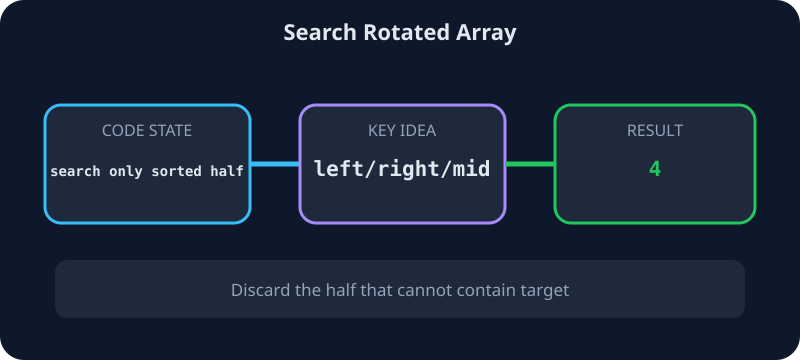

# 30. Search in Rotated Sorted Array

## 1. Problem Statement
Search for `target` in a rotated ascending array of distinct values; target 0 in `[4,5,6,7,0,1,2]` returns index 4. Source tests include singleton and absent values.

## 2. Pattern / Category
Modified binary search.

## 3. Intuition
At least one side of the midpoint is sorted; determine whether the target lies in that side, then discard the other half.


## 4. Brute Force Approach
Scan the array for the target: O(n) time and O(1) extra space. The source uses binary search instead.

## 5. Optimal Approach (My Solution)
While `l<=r`, compute `m` and return on equality. If `nums[m]>=nums[l]`, the left interval is sorted: move `l` right when target is above `nums[m]` or below `nums[l]`, otherwise move `r` left. Otherwise the right interval is sorted: move `r` left when target is below `nums[m]` or above `nums[r]`, else move `l` right.

Dry run for `[4,5,6,7,0,1,2]`, target 0: midpoint 7 makes the left side sorted, so discard it; midpoint 1 is in the sorted right side and 0 lies to its left, narrowing to index 4.



## 6. Code
```cpp
class Solution {
public:
    int search(vector<int>& nums, int target) {
        int l=0, r=nums.size()-1;
        int m = 0;
        while (l<=r){
            m = (l+r)/2;
            if(nums[m]==target){
                return m;
            }
            // Left Sorted Portion
            if(nums[m]>=nums[l]){
                if(target>nums[m] || target < nums[l])
                    l = m + 1;
                else
                    r = m - 1;
            }
            // Right Sorted Portion
            else{
                if(target<nums[m] || target > nums[r]){
                    r = m - 1;
                } else{
                    l = m + 1;
                }
            }
        }
        return -1;
    }
};
```

## 7. Complexity Analysis
O(log n) time and O(1) extra space for distinct values.

## 8. Edge Cases
- A one-element array is handled by the equality check.
- Empty input returns `-1` on typical implementations.
- The branch logic assumes no duplicate values.

## 9. Common Mistakes / Pitfalls
- Assuming both halves are sorted.
- Using inclusive/exclusive comparisons that drop a possible endpoint.
- Applying the distinct-value branch rule directly to duplicate-containing arrays.

## 10. Key Takeaways
Find the sorted half first, then use its boundaries to decide which half can contain the target.

## 11. Related Problems
- Binary Search
- Find Minimum in Rotated Sorted Array
- Search a 2D Matrix

## 12. 30-Second Interview Explanation
At each midpoint, I check whether the left half is sorted. If so, I test whether the target lies between its endpoints; otherwise I discard it. If the right half is sorted, I do the symmetric check. In the source test, the target 0 is found at index 4.
