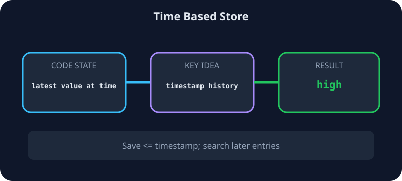

# 31. Time Based Key-Value Store

## 1. Problem Statement
Support `set(key,value,timestamp)` and `get(key,timestamp)`, returning the value at the largest timestamp not greater than the query, or `""`; after setting `foo→bar` at 1, `get(foo,3)` returns `bar`. Timestamps per key must be appended in order.

## 2. Pattern / Category
Hash map to timestamp vectors + binary search.

## 3. Intuition
Append each key's values in time order; binary-search that key's history for the latest eligible entry.


## 4. Brute Force Approach
Store all values and scan a key's history for the best eligible timestamp on each get: O(m) per query for `m` versions, O(total versions) space. This is a baseline.

## 5. Optimal Approach (My Solution)
`store` maps each string key to `{value,timestamp}` pairs. `set` appends. `get` initializes `res=""`, binary-searches indices `l..r`, and when a timestamp is `<=` the query, saves its value and searches right for a later eligible one. It returns `res`. `store[key]` also creates an empty vector for a previously unseen key; with the source's typical integer conversion of `size()-1`, that query returns empty.

Dry run from source: after `set("love","high",10)` and `set("love","low",20)`, `get("love",15)` first records `"high"` at timestamp 10, then stops before 20, returning `"high"`.



## 6. Code
```cpp
class TimeMap {
public:
    unordered_map<string,vector<pair<string,int>>> store;
    TimeMap() {
    }
    void set(string key, string value, int timestamp) {
        store[key].push_back({value,timestamp});
    }
    string get(string key, int timestamp) {
        string res = "";
        int l = 0, r = store[key].size()-1;
        while (l<=r){
            int mid = (l+r)/2;
            if (store[key][mid].second<=timestamp){
                res = store[key][mid].first;
                l = mid + 1;
            } else{
                r = mid - 1;
            }
        }
        return res;
    }
};
```

## 7. Complexity Analysis
`set` is average O(1) hash-map access plus amortized vector append. `get` is average O(log m) after an average O(1) hash lookup; space is O(V) for `V` stored versions.

## 8. Edge Cases
- Query before the first timestamp returns `""`.
- Query after the latest timestamp returns the latest value.
- Correct binary search relies on timestamps being appended in nondecreasing order for each key.

## 9. Common Mistakes / Pitfalls
- Returning the first timestamp below the query rather than searching for the largest eligible timestamp.
- Forgetting the empty-string default.
- Appending out-of-order timestamps invalidates the search assumption.

## 10. Key Takeaways
Append-only per-key histories support efficient predecessor queries with binary search.

## 11. Related Problems
- Snapshot Array
- Time-based Event Store
- Binary Search

## 12. 30-Second Interview Explanation
I store each key's ordered history in `store`. `set` appends a value and timestamp. `get` binary-searches that vector, updating `res` whenever the timestamp is no later than the query and continuing right. The source query at time 15 returns `"high"` from time 10, not the later value at 20.
