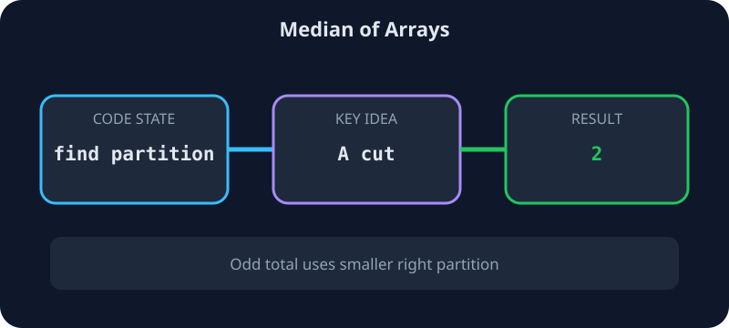

# 32. Median of Two Sorted Arrays

## 1. Problem Statement
Given two sorted arrays, return the combined median; `[1,3]` and `[2]` give 2, while `[1,2]` and `[3,4]` give 2.5. Source tests include duplicates and one empty array; at least one array must be nonempty.

## 2. Pattern / Category
Binary-search partition.

## 3. Intuition
Choose a cut in each sorted array so the left partitions contain half the values and every left value is at most every right value.


## 4. Brute Force Approach
Merge the arrays and select the middle value(s): O(m+n) time and O(m+n) extra space. This is a baseline, not the source implementation.

## 5. Optimal Approach (My Solution)
`findMedianSortedArrays` passes the shorter input as `A`. `findMedian` sets `half=total/2`, binary-searches cut `i` in A, and derives `j=half-i`. It uses `-INFINITY`/`INFINITY` at missing partition edges. When `Aleft<=Bright` and `Bleft<=Aright`, odd totals return `min(Aright,Bright)`; even totals average `max(Aleft,Bleft)` and `min(Aright,Bright)`. Otherwise it adjusts `i`.

Dry run for `[1,3]` and `[2]`: the wrapper makes `A=[2]`, `B=[1,3]`; cut `i=0,j=1` gives left max 1 and right min 2, so the odd-total median is 2.



## 6. Code
```cpp
class Solution {
public:
    double findMedian(vector<int>& A, vector<int>& B, int total) {
        int half = total / 2;
        int l = 0;
        int r = A.size();
        while (l<=r) {
            int i = (l + r) / 2;
            int j = half - i;
            double Aleft = (i > 0) ? A[i - 1] : -INFINITY;
            double Aright = (i < A.size()) ? A[i] : INFINITY;
            double Bleft = (j > 0) ? B[j - 1] : -INFINITY;
            double Bright = (j < B.size()) ? B[j] : INFINITY;
            if (Aleft <= Bright && Bleft <= Aright) {
                if (total % 2) {
                    return min(Aright, Bright);
                }
                else {
                    return (max(Aleft, Bleft) + min(Aright, Bright)) / 2.0;
                }
            }
            else if (Aleft > Bright) {
                r = i - 1;
            }
            else {
                l = i + 1;
            }
        }
        return 0.0;
    }
    double findMedianSortedArrays(vector<int>& nums1, vector<int>& nums2) {
        int total = nums1.size() + nums2.size();
        if (nums1.size() > nums2.size()) {
            return findMedian(nums2, nums1, total);
        }
        return findMedian(nums1, nums2, total);
    }
};
```

## 7. Complexity Analysis
O(log min(m,n)) time and O(1) extra space. The shorter array is the binary-search domain.

## 8. Edge Cases
- Empty one-sided input works when the other input is nonempty.
- Odd totals use the first value of the right partition; even totals average the two middle values.
- Both arrays empty are not handled as a valid case.

## 9. Common Mistakes / Pitfalls
- Searching the longer array, which may create invalid partition bounds.
- Using `max` of the right side for odd totals instead of `min(Aright,Bright)`.
- Forgetting to account for even versus odd total length.

## 10. Key Takeaways
The median is determined by partition boundaries, not by explicitly merging the arrays.

## 11. Related Problems
- Binary Search
- Kth Smallest Element in Two Sorted Arrays
- Find Kth Element of Two Sorted Arrays

## 12. 30-Second Interview Explanation
I binary-search a partition in the shorter array and derive the matching cut in the other. When both left edges are no greater than the opposite right edges, the partition is valid; I return the appropriate boundary median for odd/even length. For `[1,3]` and `[2]`, cuts produce median 2 without merging.
