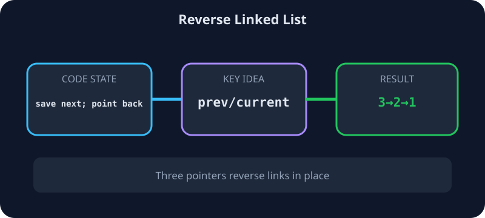

# 33. Reverse Linked List

## 1. Problem Statement
Reverse a singly linked list in place and return its new head; `1 -> 2 -> 3` becomes `3 -> 2 -> 1`. Source examples include empty and single-node lists.

## 2. Pattern / Category
Iterative pointer reversal.

## 3. Intuition
At each node, save its original next pointer before redirecting it to the previous node.


## 4. Brute Force Approach
Copy node values into an array, then build a reversed list: O(n) time and O(n) extra space. This is a baseline; the source rewires links in place.

## 5. Optimal Approach (My Solution)
An empty `head` is returned directly. `prev` starts null and `crr` starts at head. Each loop saves `crr->next` in `next`, points `crr->next` to `prev`, then advances `prev` and `crr`. Return `prev`.

Dry run for `1 -> 2 -> 3`: after processing node 1, `1 -> null`; after node 2, `2 -> 1`; after node 3, `3 -> 2 -> 1`, returned through `prev`.



## 6. Code
```cpp
struct ListNode {
    int val;
    ListNode *next;
    ListNode() : val(0), next(nullptr) {}
    ListNode(int x) : val(x), next(nullptr) {}
    ListNode(int x, ListNode *next) : val(x), next(next) {}
};

class Solution {
public:
    ListNode* reverseList(ListNode* head) {
        if(head==NULL) return head;
        ListNode* prev = NULL, *crr = head, *next = crr->next;
        while(crr!=NULL){
            next = crr->next;
            crr->next = prev;
            prev = crr;
            crr = next;
        }
        return prev;
    }
};
```

## 7. Complexity Analysis
O(n) time and O(1) auxiliary space.

## 8. Edge Cases
- Empty list returns null.
- A single node remains unchanged.
- The next pointer must be saved before overwriting it.

## 9. Common Mistakes / Pitfalls
- Losing the remainder of the list by reversing before saving `next`.
- Returning the original head, which becomes the tail.
- Forgetting to terminate the new tail with null.

## 10. Key Takeaways
Three pointers are enough to reverse links iteratively without allocating nodes.

## 11. Related Problems
- Reverse Nodes in K Groups
- Reorder a Linked List
- Merge Two Sorted Lists

## 12. 30-Second Interview Explanation
I maintain `prev`, `crr`, and `next`. For each node I save its old successor, point it backward to `prev`, and advance. When traversal ends, `prev` is the new head. The source list `1 -> 2 -> 3` becomes `3 -> 2 -> 1`.
