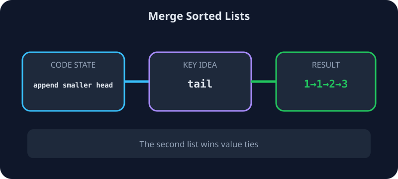

# 34. Merge Two Sorted Linked Lists

## 1. Problem Statement
Merge two sorted linked lists into one sorted list; `[1,2,4]` and `[1,3,4]` produce `[1,1,2,3,4,4]`. Source tests include empty inputs and duplicates.

## 2. Pattern / Category
Two-pointer merge with a new output list.

## 3. Intuition
Repeatedly append the smaller current value, then append the remaining list after one input ends.


## 4. Brute Force Approach
Copy all values into an array, sort them, and build a list: O((m+n) log(m+n)) time and O(m+n) extra space. This is only a baseline.

## 5. Optimal Approach (My Solution)
`head` and `tail` begin null. While both lists remain, the code calls `insertIntoList` with the smaller value; ties select `list2`. It then appends all leftover values from either list and returns `head`. The helper allocates a fresh `ListNode` for every value, so the input nodes are not reused.

Dry run from source lists `1 -> 2 -> 4` and `1 -> 3 -> 4`: the first equal values select list2's 1, then list1's 1, followed by 2, 3, and the remaining 4s, yielding `1 -> 1 -> 2 -> 3 -> 4 -> 4`.



## 6. Code
```cpp
struct ListNode {
    int val;
    ListNode *next;
    ListNode() : val(0), next(nullptr) {}
    ListNode(int x) : val(x), next(nullptr) {}
    ListNode(int x, ListNode *next) : val(x), next(next) {}
};

class Solution {
public:
    void insertIntoList(ListNode*& head, ListNode*& tail, int val){
        if(head==NULL){
            head = new ListNode(val);
            tail = head;
            return;
        }
        tail->next = new ListNode(val);
        tail = tail->next;
    }
    ListNode* mergeTwoLists(ListNode* list1, ListNode* list2) {
        ListNode* head = NULL;
        ListNode* tail = NULL;
        while(list1!=NULL && list2!=NULL){
            if(list1->val<list2->val){
                insertIntoList(head, tail, list1->val);
                list1 = list1->next;
            } else{
                insertIntoList(head, tail, list2->val);
                list2 = list2->next;
            }
        }
        while(list1!=NULL){
            insertIntoList(head, tail, list1->val);
            list1 = list1->next;
        }
        while(list2!=NULL){
            insertIntoList(head, tail, list2->val);
            list2 = list2->next;
        }
        return head;
    }
};
```

## 7. Complexity Analysis
O(m+n) time and O(m+n) newly allocated output nodes; O(1) additional pointer state.

## 8. Edge Cases
- Both lists empty returns null.
- One empty list is copied into a new output list.
- Equal values are preserved; the code chooses from list2 first on ties.

## 9. Common Mistakes / Pitfalls
- Reusing input nodes in an explanation when this code allocates fresh ones.
- Forgetting to append the nonempty remainder.
- Assuming output stability for tied nodes is from list1; it is list2 here.

## 10. Key Takeaways
The merge is linear, but this implementation creates a separate node for every output value.

## 11. Related Problems
- Merge K Sorted Lists
- Merge Sorted Array
- Linked List Cycle

## 12. 30-Second Interview Explanation
I compare the current values in both lists and append the smaller one through `insertIntoList`, which allocates a new node. Once one input ends, I append the remainder of the other. For the source lists, equal 1s are both kept and the final values merge to `1,1,2,3,4,4`.
