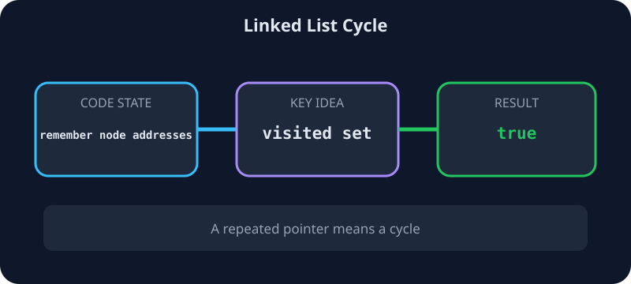

# 35. Linked List Cycle

## 1. Problem Statement
Determine whether following `next` pointers revisits a node; source list `3 -> 2 -> 0 -> -4 -> 2...` has a cycle, while an ending `NULL` means false. Tests include single-node and null lists.

## 2. Pattern / Category
Pointer identity tracking with a hash set.

## 3. Intuition
If the traversal reaches a node address already seen, the list has looped; reaching null means no cycle.


## 4. Brute Force Approach
For each node, compare it with all earlier nodes: O(n²) time and O(n) stored references. This baseline is not the source implementation.

## 5. Optimal Approach (My Solution)
`nodesReferences` stores node pointers. While `head` is non-null, the method checks whether its address is already present; if so it returns true. Otherwise it inserts the pointer and advances `head=head->next`. Reaching null returns false.

Dry run from the source cycle `3 -> 2 -> 0 -> -4 -> 2`: the first pass stores addresses for 3, 2, 0, and -4; traversal returns to the same node 2 address, so it returns true.



## 6. Code
```cpp
struct ListNode {
    int val;
    ListNode *next;
    ListNode(int x) : val(x), next(NULL) {}
};

class Solution {
public:
    bool hasCycle(ListNode *head) {
        unordered_set<ListNode *> nodesReferences;
        while(head!=NULL){
            if(nodesReferences.count(head)){
                return true;
            }
            nodesReferences.insert(head);
            head=head->next;
        }
        return false;
    }
};
```

## 7. Complexity Analysis
O(n) average time using hash-set operations and O(n) space for visited node addresses.

## 8. Edge Cases
- Null head returns false.
- A self-loop is detected on the second visit.
- Values may repeat without a cycle; identity, not `val`, is tracked.

## 9. Common Mistakes / Pitfalls
- Storing node values instead of node pointers.
- Treating `head->next != nullptr` as proof of a cycle.
- Advancing without checking for a repeated node.

## 10. Key Takeaways
Cycle detection must compare node identity; the source uses extra memory to remember visited nodes.

## 11. Related Problems
- Find the Duplicate Number
- Linked List Cycle II
- Happy Number

## 12. 30-Second Interview Explanation
I walk through the list and store each node pointer in `nodesReferences`. If a pointer appears again, a cycle has brought traversal back to an existing node; if traversal reaches null, there is no cycle. The source cycle revisits the node with value 2 and returns true.
