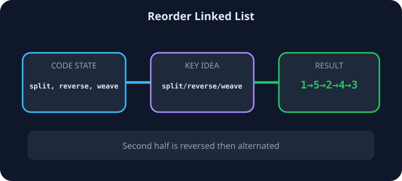

# 36. Reorder List

## 1. Problem Statement
Reorder a list in place as first, last, second, second-last, and so on; `[1,2,3,4,5]` becomes `[1,5,2,4,3]`. Source tests include odd/even lengths, one node, and empty input.

## 2. Pattern / Category
Slow/fast midpoint, reverse second part, then weave.

## 3. Intuition
Split near the middle, reverse the latter chain, and alternate nodes from the first and reversed halves.


## 4. Brute Force Approach
Store all node pointers in an array and reconnect from both ends: O(n) time and O(n) extra space. This is a baseline, not the source solution.

## 5. Optimal Approach (My Solution)
`sP`/`fP` advance one/two nodes. When `fP` reaches the end (or its next-next is null), the code assigns `mid=sP->next` and cuts `sP->next`. It reverses the chain beginning at `mid` with `prev`, then alternates `first` and `second`, saving `fNext`/`sNext` before relinking. `reorderList` modifies links and returns void.

Dry run for source list `1 -> 2 -> 3 -> 4 -> 5`: the cut leaves `1 -> 2 -> 3` and `4 -> 5`; reversing yields `5 -> 4`; weaving gives `1 -> 5 -> 2 -> 4 -> 3`.



## 6. Code
```cpp
struct ListNode {
    int val;
    ListNode *next;
    ListNode() : val(0), next(nullptr) {}
    ListNode(int x) : val(x), next(nullptr) {}
    ListNode(int x, ListNode *next) : val(x), next(next) {}
};

class Solution {
public:
    void reorderList(ListNode* head) {
        ListNode* sP = head, *fP = head, *mid = NULL;
        while(fP!=NULL){
            if(fP->next==NULL){
                mid = sP->next;
                sP->next = NULL;
                break;
            }
            if(fP->next->next==NULL){
                mid = sP->next;
                sP->next = NULL;
                break;
            }
            sP = sP->next;
            fP = fP->next->next;
        }
        ListNode* prev = NULL;
        while(mid!=NULL){
            ListNode* next = mid->next;
            mid->next = prev;
            prev = mid;
            mid = next;
        }
        ListNode *second = prev, *first = head;
        while(second!=NULL && first!=NULL){
            ListNode* fNext = first->next;
            ListNode* sNext = second->next;
            first->next = second;
            second->next = fNext;
            second = sNext;
            first = fNext;
        }
    }
};
```

## 7. Complexity Analysis
O(n) time for finding the split, reversing, and weaving; O(1) auxiliary space.

## 8. Edge Cases
- Empty and one-node lists remain unchanged.
- Even and odd lengths split at different positions but both halves weave correctly.
- The function rearranges the original nodes; it does not allocate replacements.

## 9. Common Mistakes / Pitfalls
- Reversing the second half before separating it from the first.
- Losing a node by not saving `fNext` or `sNext` before relinking.
- Creating a cycle by leaving the first half connected to the second before the weave.

## 10. Key Takeaways
The three in-place phases are split, reverse, and alternate.

## 11. Related Problems
- Reverse Linked List
- Reverse Nodes in K Groups
- Merge Two Sorted Lists

## 12. 30-Second Interview Explanation
I locate the midpoint with `sP` and `fP`, cut after the first half, reverse the chain beginning at `mid`, and weave the reversed nodes between nodes from the first chain. For `[1,2,3,4,5]`, that yields `[1,5,2,4,3]` without extra node storage.
