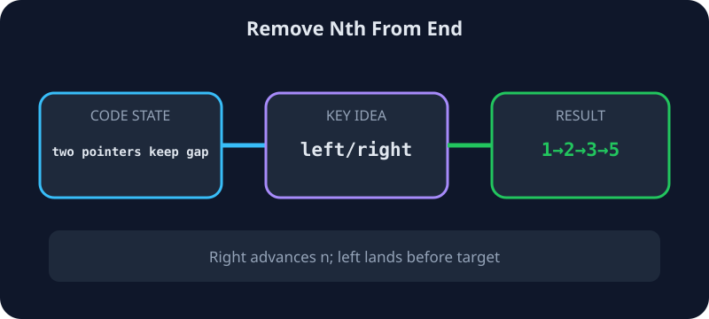

# 37. Remove Nth Node From End of List

## 1. Problem Statement
Remove the node `n` positions from the end and return the head; `[1,2,3,4,5], n=2` becomes `[1,2,3,5]`. Source tests include head/tail removal; valid `n` is assumed.

## 2. Pattern / Category
Two pointers with a dummy head.

## 3. Intuition
Advance one pointer `n` nodes, then move both pointers together; when the lead reaches null, the lagging pointer is before the target.


## 4. Brute Force Approach
Count the list length, then walk to position `length-n` and unlink the node: O(n) time and O(1) extra space. This is a baseline alternative.

## 5. Optimal Approach (My Solution)
The code allocates `dummy(0,head)`, sets `left=dummy` and `right=head`. It advances `right` while `n>0 && right!=NULL`, decrementing `n`; then advances both until `right` is null. It removes `left->next` by skipping it and returns `dummy->next`.

Dry run from `[1,2,3,4,5], n=2`: move `right` two nodes to 3; advance both until `right` is null and `left` is at 3; link 3 to 5, yielding `[1,2,3,5]`.



## 6. Code
```cpp
struct ListNode {
    int val;
    ListNode *next;
    ListNode() : val(0), next(nullptr) {}
    ListNode(int x) : val(x), next(nullptr) {}
    ListNode(int x, ListNode *next) : val(x), next(next) {}
};

class Solution {
public:
    ListNode* removeNthFromEnd(ListNode* head, int n) {
        ListNode*dummy = new ListNode(0, head);
        ListNode* left = dummy;
        ListNode* right = head;
        while(n>0 && right!=NULL){
            right = right->next;
            n--;
        }
        while(right!=NULL){
            left=left->next;
            right=right->next;
        }
        left->next=left->next->next;
        return dummy->next;
    }
};
```

## 7. Complexity Analysis
O(n) time and O(1) auxiliary space. The source also allocates one dummy node.

## 8. Edge Cases
- Removing the only node works for valid `n=1`.
- Removing the head is handled because `left` can remain at `dummy`.
- The method assumes `1 <= n <= list length`; invalid `n` is not checked. The allocated dummy is not deleted.

## 9. Common Mistakes / Pitfalls
- Advancing the lead pointer `n+1` nodes when using this exact `left=dummy,right=head` setup.
- Forgetting the dummy is what permits removing the original head.
- Calling `left->next->next` when the requested `n` is invalid.

## 10. Key Takeaways
A fixed lead distance locates the predecessor of the node to unlink in one traversal.

## 11. Related Problems
- Linked List Cycle
- Reverse Linked List
- Remove Duplicates from Sorted List

## 12. 30-Second Interview Explanation
I create a dummy before the head and keep `left` there while moving `right` forward `n` nodes. Then both pointers advance until `right` reaches null. `left->next` is the target, so I skip it and return `dummy->next`. The source removes node 4 from `[1,2,3,4,5]` when `n=2`.
