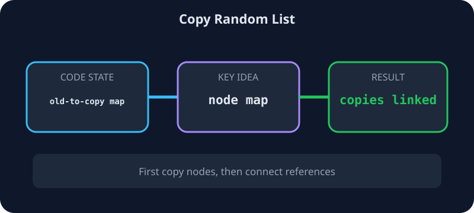

# 38. Copy List with Random Pointer

## 1. Problem Statement
Deep-copy a list with `next` and arbitrary `random` pointers; source list `[1,null] -> [2,1]` should copy to the same values and copied references. Random may point to any node or null; tests include self-links and an empty list.

## 2. Pattern / Category
Hash map from original node addresses to copied nodes.

## 3. Intuition
Create all copied nodes first, then use the map to connect copied `next` and `random` references.


## 4. Brute Force Approach
For every original node, search the full list to locate the copies corresponding to its two pointers: O(n²) time and O(n) output/map storage. The source uses a hash map.

## 5. Optimal Approach (My Solution)
First traversal fills `oldToCopMap[current]` with a newly allocated node for every original node. The second traversal maps each `current->next` and `current->random` to copied pointers, then advances. It returns `oldToCopMap[head]`; null keys default to null pointers, so null links stay null.

Dry run for source test `[1,2]` with random indices `[-1,0]`: first allocate copies 1′ and 2′; then set 1′.next=2′ and 1′.random=null, and 2′.next=null and 2′.random=1′.



## 6. Code
```cpp
class Node {
public:
    int val;
    Node* next;
    Node* random;
    Node(int _val) {
        val = _val;
        next = NULL;
        random = NULL;
    }
};

class Solution {
public:
    Node* copyRandomList(Node* head) {
        Node* current = head;
        Node* copy = NULL;
        unordered_map<Node*,Node*> oldToCopMap;
        while(current!=NULL){
            oldToCopMap[current] = new Node(current->val);
            current = current->next;
        }
        current = head;
        while(current!=NULL){
            Node* copy = oldToCopMap[current];
            copy->next = oldToCopMap[current->next];
            copy->random = oldToCopMap[current->random];
            current = current->next;
        }
        return oldToCopMap[head];
    }
};
```

## 7. Complexity Analysis
O(n) average time and O(n) space for the map and copied nodes; unordered-map lookup/insertion is average O(1).

## 8. Edge Cases
- Null head returns null.
- A random self-link resolves to the same copied node.
- `operator[]` for null `next`/`random` keys inserts a null mapping.

## 9. Common Mistakes / Pitfalls
- Copying only the `next` chain and leaving random pointers aimed at original nodes.
- Trying to link random pointers before their target copies exist.
- Returning an original node rather than its mapped copy.

## 10. Key Takeaways
Allocate all nodes before wiring arbitrary cross-references.

## 11. Related Problems
- Clone Graph
- Linked List Cycle
- Serialize and Deserialize Binary Tree

## 12. 30-Second Interview Explanation
I make a map from every original node pointer to a newly allocated copy in a first pass. In a second pass, I connect each copy's `next` and `random` to the corresponding mapped copies. For the source two-node list, node 2's copied random pointer is connected back to copied node 1, not the original.
