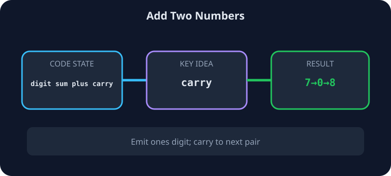

# 39. Add Two Numbers

## 1. Problem Statement
Add two nonnegative integers represented by reverse-order digit lists; `[2,4,3]+[5,6,4]` returns `[7,0,8]` (807). Source examples include unequal lengths and final carry; digits are decimal.

## 2. Pattern / Category
Linked-list digit arithmetic with carry.

## 3. Intuition
Add corresponding digits plus carry, emit the ones digit, and continue until both lists and carry are exhausted.


## 4. Brute Force Approach
Convert both lists to full integers, add, then convert the result back to a list. This can overflow for long lists; a digit-by-digit method is safer. The baseline uses O(m+n) time and output space.

## 5. Optimal Approach (My Solution)
`dummy` anchors a newly allocated result and `current` appends nodes. While either input remains or `carry` is nonzero, absent digits are treated as 0; `val1+val2+carry` is split into new carry with `/10` and digit with `%10`. Input pointers advance only when non-null. Return `dummy->next`.

Dry run for `[2,4,3]` and `[5,6,4]`: sums are 7, 10, and 8; the middle digit is 0 with carry 1, giving `[7,0,8]`.



## 6. Code
```cpp
struct ListNode {
    int val;
    ListNode *next;
    ListNode() : val(0), next(nullptr) {}
    ListNode(int x) : val(x), next(nullptr) {}
    ListNode(int x, ListNode *next) : val(x), next(next) {}
};

class Solution {
public:
    ListNode* addTwoNumbers(ListNode* l1, ListNode* l2) {
        ListNode* dummy = new ListNode();
        ListNode* current = dummy;
        int carry = 0;
        while(l1!=NULL || l2!=NULL || carry){
            int val1 = l1!=NULL ? l1->val : 0;
            int val2 = l2!=NULL ? l2->val : 0;
            int val = val1 + val2 + carry;
            carry = val / 10;
            val = val%10;
            current->next = new ListNode(val);
            current = current->next;
            l1= l1!=NULL ? l1->next : NULL;
            l2= l2!=NULL ? l2->next : NULL;
        }
        return dummy->next;
    }
};
```

## 7. Complexity Analysis
O(max(m,n)) time and O(max(m,n)+1) newly allocated output nodes; O(1) arithmetic state.

## 8. Edge Cases
- Unequal list lengths use zero for the missing digit.
- A final carry creates one extra node.
- The source loop returns null if both input pointers are null (not a demonstrated valid number representation).

## 9. Common Mistakes / Pitfalls
- Reading digits in forward order even though lists are least-significant-first.
- Dropping the final carry.
- Using a numeric conversion that overflows for long input lists.
- The allocated dummy node is not freed by the source.

## 10. Key Takeaways
Digit-by-digit addition keeps arithmetic bounded and handles long lists naturally.

## 11. Related Problems
- Add Binary
- Multiply Strings
- Merge Two Sorted Lists

## 12. 30-Second Interview Explanation
I walk both reverse-order lists together, treating a missing digit as zero. Each step adds the digits and carry, appends the remainder modulo 10, and keeps the quotient as the next carry. For `342+465`, the list digits are `[2,4,3]+[5,6,4]`, producing `[7,0,8]` (807).
