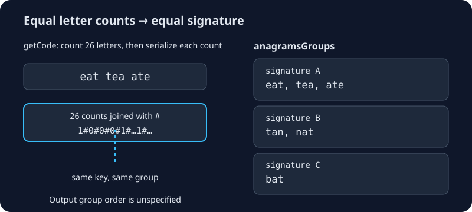

# 4. Group Anagrams

## 1. Problem Statement
Group strings that contain the same lowercase letters with the same frequencies. Source example: `["eat","tea","tan","ate","nat","bat"]` forms groups for the anagrams; the tests also include empty strings and single letters.

## 2. Pattern / Category
Frequency signature + hash map.

## 3. Intuition
Anagrams share the same 26 letter counts, so use that count vector as a common key.



## 4. Brute Force Approach
As a baseline, sort each string's characters and group equal sorted strings. For `g` strings of maximum length `L`, this is O(S log L) time for total character count `S` and O(S) extra space; it is not the implementation below.

## 5. Optimal Approach (My Solution)
`getCode(testString)` counts lowercase letters in `freqMap[26]`, then appends each count and `#` to `code`. `groupAnagrams` computes that key for each copied `str`, pushes it into `anagramsGroups[code]`, then copies each map group into `ans`.

Dry run from the source case `["eat","tea","tan","ate","nat","bat"]`: `eat` and `tea` both have `a:1,e:1,t:1` and receive the same code; `tan` and `nat` share another; `bat` has its own. The map then yields three groups (their output order is unspecified).



## 6. Code
```cpp
class Solution {
private:
   string getCode(string testString){
    int freqMap[26]={0};
    int n = testString.length();
    for(int i=0; i<n; i++){
      freqMap[testString[i] - 'a']++;
    }
    string code = "";
    for(int n: freqMap){
      code+=to_string(n);
      code+="#";
    }
    return code;
   }
public:
    vector<vector<string>> groupAnagrams(vector<string>& strs) {
      unordered_map<string,vector<string>> anagramsGroups;
      for(string str:strs){
        string code = getCode(str);
        if(anagramsGroups.find(code)!=anagramsGroups.end()){
          anagramsGroups[code].push_back(str);
          continue;
        }
        anagramsGroups[code].push_back(str);
      }
      vector<vector<string>> ans;
      for(auto& codeAndCorrespondingAnagrams: anagramsGroups){
        ans.push_back(codeAndCorrespondingAnagrams.second);
      }
      return ans;
    }
};
```

## 7. Complexity Analysis
For `g` strings with `S` total characters and maximum length `L`, counting is O(S); serializing and hashing 26 textual counts costs O(26 log L) per key in the worst case, with average O(1) hash-table operations aside from key processing. Space is O(S + 26g log L) for copied grouped strings and keys (excluding input).

## 8. Edge Cases
- Empty input returns no groups; an empty string has all-zero signature.
- Duplicate strings remain together in the same vector.
- The code assumes lowercase English letters because it indexes `testString[i] - 'a'`.

## 9. Common Mistakes / Pitfalls
- Sorting or comparing strings is not what this source implements.
- Omitting a delimiter between integer counts could make signatures ambiguous.
- Group order is not guaranteed because `anagramsGroups` is unordered.

## 10. Key Takeaways
Use a frequency signature to group anagrams without sorting each string; hash-map iteration does not preserve group order.

## 11. Related Problems
- Valid Anagram
- Find All Anagrams in a String
- Top K Frequent Elements

## 12. 30-Second Interview Explanation
I count each lowercase letter in `getCode` and serialize the 26 counts with separators. In `groupAnagrams`, strings with the same signature go into the same `anagramsGroups` entry, and I collect those vectors into the answer. The source's example puts `eat` and `tea` together because their counts match.
