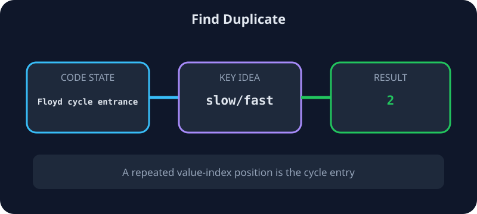

# 40. Find the Duplicate Number

## 1. Problem Statement
An array of `n+1` values from `[1,n]` contains a repeated value; `[1,3,4,2,2]` returns 2 without modifying input. Source tests include multiple repetitions; valid range and existence of a duplicate are assumed.

## 2. Pattern / Category
Floyd cycle detection on an index-linked sequence.

## 3. Intuition
Treat each value as the next index. The duplicate creates a cycle; finding the cycle entrance identifies that value.


## 4. Brute Force Approach
Compare each value with earlier values: O(n²) time and O(1) extra space. A hash set is another O(n)-space baseline. Neither is used in the source.

## 5. Optimal Approach (My Solution)
`slow` starts at `nums[0]`; `fast` starts at `nums[nums[0]]`. They move one and two index-jumps until they meet inside the cycle. Then `slow2=0`; `slow` and `slow2` advance one jump each until they meet at the cycle entrance, which is returned.

Dry run from `[1,3,4,2,2]`: following array indices gives `0→1→3→2→4→2...`; the path cycles at index/value 2. After the second phase, the pointers meet at 2 and return it.



## 6. Code
```cpp
class Solution {
public:
    int findDuplicate(vector<int>& nums) {
        int slow = 0;
        int fast = 0;
        slow = nums[slow];
        fast = nums[nums[fast]];
        while(slow!=fast){
            slow = nums[slow];
            fast=nums[nums[fast]];
        }
        int slow2 = 0;
        while(slow2!=slow){
            slow = nums[slow];
            slow2 = nums[slow2];
        }
        return slow;
    }
};
```

## 7. Complexity Analysis
O(n) time and O(1) extra space; the input vector is not modified.

## 8. Edge Cases
- The method relies on values being valid indices in `[1,n]` and on at least one duplicate.
- It returns the duplicate even when it appears more than twice.
- Empty or out-of-contract input is not guarded.

## 9. Common Mistakes / Pitfalls
- Starting phase two with the wrong pointer or advancing one pointer by two.
- Assuming the repeated value is the same as the first array element.
- Treating the input values as list nodes without following the index mapping.

## 10. Key Takeaways
The repeated number is the entrance to the cycle induced by `i -> nums[i]`.

## 11. Related Problems
- Linked List Cycle
- Linked List Cycle II
- Find the Duplicate Number with a Set

## 12. 30-Second Interview Explanation
I view each array value as a next pointer. Floyd's tortoise-and-hare first finds a meeting point in the resulting cycle. Then I start `slow2` at index 0 and move it with `slow` one jump at a time; their meeting point is the duplicate. For the source array `[1,3,4,2,2]`, that entrance is 2.
