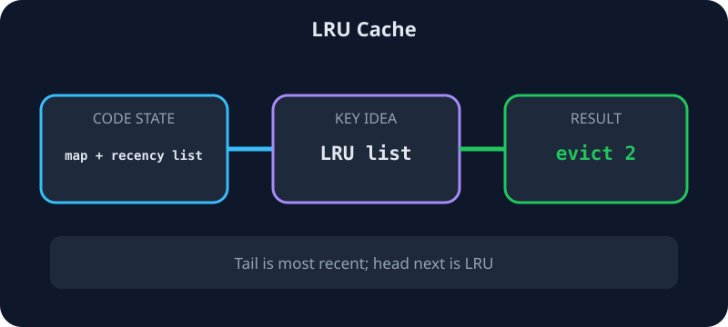

# 41. LRU Cache

## 1. Problem Statement
Implement a fixed-capacity cache where `get` returns a value or `-1` and `put` inserts/updates; with capacity 2, `put(1,1),put(2,2),get(1),put(3,3)` evicts key 2. Source tests include capacity 1 and updates.

## 2. Pattern / Category
Hash map + doubly linked list.

## 3. Intuition
Use the map for direct node lookup and a list ordered from least-recent at `head->next` to most-recent at `tail->prev`.


## 4. Brute Force Approach
Store key/value pairs and scan to find keys, moving an accessed pair to the recent end; operations can be O(capacity). This is a baseline, not the source implementation.

## 5. Optimal Approach (My Solution)
`head`/`tail` are sentinels. `remove` unlinks a node; `insert` places it immediately before `tail`. `get` returns -1 for a missing key; otherwise it removes/reinserts the node as most recent. `put` deletes an existing node if present, inserts a fresh node, and if `cache.size()>capacity`, erases and deletes `head->next`.

Dry run from capacity 2: put 1, put 2, get 1 moves 1 to the tail side, then put 3 exceeds capacity; `head->next` is key 2, so key 2 is evicted and `get(2)` returns -1.



## 6. Code
```cpp
class Node{
public:
    int key, value;
    Node *next, *prev;
    Node(int key, int value){
        this->key = key;
        this->value = value;
        next = NULL;
        prev = NULL;
    }
};

class LRUCache {
private:
    int capacity;
    Node* head, *tail;
    unordered_map<int,Node*> cache;
public:
    LRUCache(int capacity) {
        this->capacity = capacity;
        head = new Node(0,0);
        tail = new Node(0,0);
        head->next = tail;
        tail->prev = head;
    }
    void remove(Node* node){
        Node* prev = node->prev, *nxt = node->next;
        prev->next = nxt;
        nxt->prev = prev;
        node->prev = NULL;
        node->next = NULL;
    }
    void insert(Node* node){
        Node* prev = tail->prev, *nxt = tail;
        prev->next = node, node->prev = prev;
        nxt->prev = node, node->next = nxt;
    }
    int get(int key) {
        if (!cache.count(key))
            return -1;
        remove(cache[key]);
        insert(cache[key]);
        return cache[key]->value;
    }
    void put(int key, int value) {
        if (cache.count(key)){
            remove(cache[key]);
            delete cache[key];
        }
        cache[key] = new Node(key,value);
        insert(cache[key]);
        if(cache.size()>capacity){
            Node* LRU = head->next;
            cache.erase(LRU->key);
            remove(LRU);
            delete LRU;
        }
    }
};
```

## 7. Complexity Analysis
`get` and `put` are average O(1) because the map lookup is average O(1) and list operations are O(1). Space is O(capacity) for cache nodes plus two sentinels.

## 8. Edge Cases
- Missing keys return -1.
- Updating an existing key replaces its node and makes it most recent.
- Source tests use positive capacities; zero-capacity behavior is not specified.

## 9. Common Mistakes / Pitfalls
- Updating recency in the map but not in the list.
- Evicting `tail->prev` (most recent) instead of `head->next` (least recent).
- Forgetting to erase an evicted key from `cache`.

## 10. Key Takeaways
The linked list tracks recency order; the hash map connects keys to nodes directly.

## 11. Related Problems
- LFU Cache
- Design Twitter
- Time Based Key-Value Store

## 12. 30-Second Interview Explanation
I pair a hash map with a doubly linked list whose sentinels bound the least- and most-recent entries. A successful `get` moves its node to the tail; `put` inserts or replaces there and evicts `head->next` when over capacity. The source capacity-2 sequence evicts key 2 after accessing key 1 and inserting key 3.
