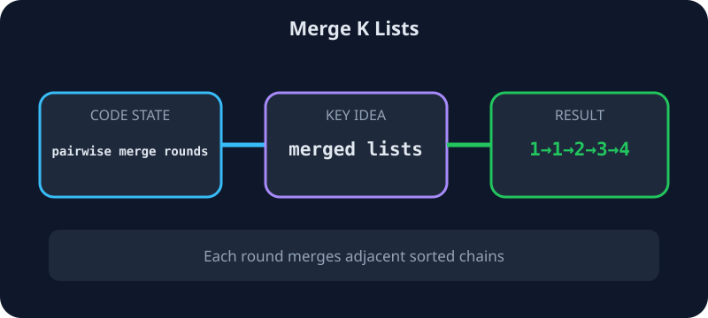

# 42. Merge K Sorted Lists

## 1. Problem Statement
Merge `k` sorted linked lists into one sorted list; `[1,4,5]`, `[1,3,4]`, `[2,6]` become `[1,1,2,3,4,4,5,6]`. Source tests include empty members and duplicates.

## 2. Pattern / Category
Pairwise divide-and-conquer merging.

## 3. Intuition
Merge lists in pairs each round; each round roughly halves the number of lists.


## 4. Brute Force Approach
Collect all `N` values and sort them, then build or relink a list: O(N log N) time and O(N) array storage. It is not the source approach.

## 5. Optimal Approach (My Solution)
If `lists` is empty, return null. While more than one list remains, build `mergedLists`; for each `i` stepping by 2, merge `lists[i]` with `lists[i+1]` if present (otherwise null). Assign the merged vector back to `lists`. `merge` reuses input nodes and attaches the smaller current node to `tail`, then appends any remaining chain.

Dry run from source lists `[1,4,5]`, `[1,3,4]`, `[2,6]`: first round merges the first two and carries the third unchanged; the next round merges those results into `[1,1,2,3,4,4,5,6]`.


## 6. Code
```cpp
struct ListNode {
    int val;
    ListNode *next;
    ListNode() : val(0), next(nullptr) {}
    ListNode(int x) : val(x), next(nullptr) {}
    ListNode(int x, ListNode *next) : val(x), next(next) {}
};

class Solution {
public:
    ListNode* mergeKLists(vector<ListNode*>& lists) {
        if(lists.size() == 0){
            return NULL;
        }
        while (lists.size()>1){
            vector<ListNode*> mergedLists;
            for (int i=0; i<lists.size(); i+=2){
                ListNode* l1 = lists[i];
                ListNode* l2 = i+1<lists.size() ? lists[i+1] : NULL;
                mergedLists.push_back(merge(l1,l2));
            }
            lists = mergedLists;
        }
        return lists[0];
    }
    ListNode* merge(ListNode* l1, ListNode* l2){
        ListNode* dummy = new ListNode();
        ListNode* tail = dummy;
        while(l1 && l2){
            if(l1->val<l2->val){
                tail->next = l1;
                l1 = l1->next;
            } else{
                tail->next = l2;
                l2 = l2->next;
            }
            tail = tail->next;
        }
        if(l1){
            tail->next = l1;
        }
        if(l2){
            tail->next = l2;
        }
        return dummy->next;
    }
};
```

## 7. Complexity Analysis
For `N` total nodes and `k` lists, O(N log k) time; the vector of intermediate list heads uses O(k) space. Existing data nodes are relinked, not copied. Each `merge` allocates a dummy node that the source does not free.

## 8. Edge Cases
- Empty `lists` returns null; a single list is returned unchanged.
- Null entries are accepted by `merge`.
- The method replaces the caller's `lists` vector with intermediate merged heads.

## 9. Common Mistakes / Pitfalls
- Forgetting an unpaired list at the end of a round.
- Copying values when the source relinks nodes.
- Claiming a min-heap implementation; this code merges pairs by rounds.

## 10. Key Takeaways
Pairwise merge repeats a linear two-list merge over logarithmically many rounds.

## 11. Related Problems
- Merge Two Sorted Lists
- Sort List
- Kth Smallest Element in a Sorted Matrix

## 12. 30-Second Interview Explanation
I repeatedly merge adjacent pairs of lists and replace the vector with the merged heads. Each round halves the list count, while each node is processed once per round, so total work is O(N log k). In the source test, the three lists become two lists in round one, then one sorted list in round two.
