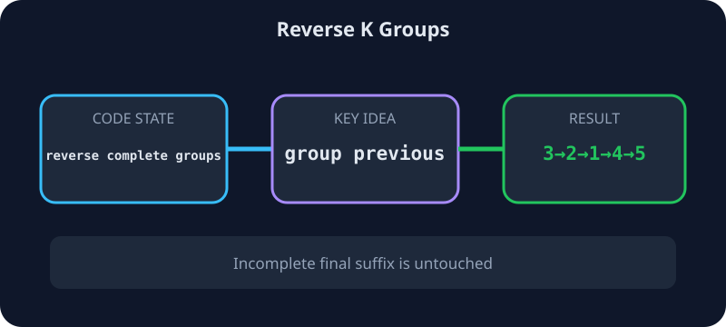

# 43. Reverse Nodes in K-Group

## 1. Problem Statement
Reverse linked-list nodes in complete groups of size `k`, leaving a final incomplete group unchanged; `[1,2,3,4,5], k=2` becomes `[2,1,4,3,5]`. Tests include `k=1` and `k` larger than the list; `k>=1` is assumed.

## 2. Pattern / Category
In-place linked-list group reversal.

## 3. Intuition
Find the kth node first; if it exists, reverse the links up to that boundary, reconnect the group, and continue.


## 4. Brute Force Approach
Copy node pointers into an array, reverse each complete block, then rebuild links: O(n) time and O(n) extra space. This is a baseline, not the source method.

## 5. Optimal Approach (My Solution)
`groupPrev` marks the node before a group. `getKthNode(groupPrev,k)` advances k links; if null, the loop stops without touching the incomplete suffix. `groupNext=kthNode->next` is the boundary, and `prev` starts there. The inner loop reverses until `curr==groupNext`; then the old group head becomes the new `groupPrev`.

Dry run for `[1,2,3,4,5], k=3`: the first kth node is 3; reversing links before `groupNext=4` yields `3->2->1->4`. The next group lacks three nodes, so 4 and 5 stay as-is.



## 6. Code
```cpp
struct ListNode {
    int val;
    ListNode *next;
    ListNode() : val(0), next(nullptr) {}
    ListNode(int x) : val(x), next(nullptr) {}
    ListNode(int x, ListNode *next) : val(x), next(next) {}
};

class Solution {
public:
    ListNode* reverseKGroup(ListNode* head, int k) {
        ListNode* dummy = new ListNode();
        dummy->next = head;
        ListNode* groupPrev = dummy;
        while (true){
            ListNode* kthNode = getKthNode(groupPrev,k);
            if (!kthNode){
                break;
            }
            ListNode* groupNext = kthNode->next;
            ListNode* prev = kthNode->next;
            ListNode* curr = groupPrev->next;
            while(curr!=groupNext){
                ListNode* tmp = curr->next;
                curr->next = prev;
                prev = curr;
                curr = tmp;
            }
            ListNode* temp = groupPrev->next;
            groupPrev->next = kthNode;
            groupPrev = temp;
        }
        return dummy->next;
    }
    ListNode* getKthNode(ListNode* curr, int k ){
        while (curr && k>=1){
            curr = curr->next;
            k-=1;
        }
        return curr;
    }
};
```

## 7. Complexity Analysis
O(n) time: each node is traversed a bounded number of times; O(1) auxiliary space, plus one dummy node.

## 8. Edge Cases
- `k=1` leaves every group unchanged.
- If fewer than `k` nodes remain, `getKthNode` returns null and the suffix is untouched.
- The intended contract requires `k>=1`; with `k=0` the helper returns `groupPrev` and the algorithm can corrupt links.

## 9. Common Mistakes / Pitfalls
- Reversing an incomplete final group.
- Setting the first reversed pointer to null instead of `groupNext`.
- Failing to reconnect the prior group to the newly reversed head.

## 10. Key Takeaways
The `groupNext` boundary lets each group reverse in place while preserving the rest.

## 11. Related Problems
- Reverse Linked List
- Reorder List
- Swap Nodes in Pairs

## 12. 30-Second Interview Explanation
For each group I locate its kth node before changing links. If it exists, I reverse the group with `prev` initialized to the next group's head, reconnect through `groupPrev`, and advance to the old group head. The source example with k=3 changes `[1,2,3,4,5]` to `[3,2,1,4,5]`.
