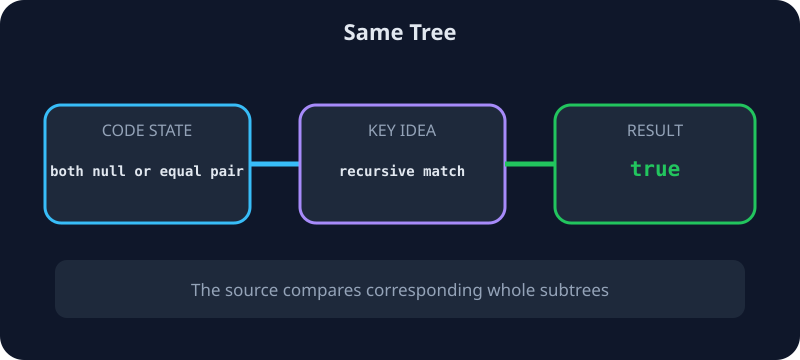

# 44. Same Tree

## 1. Problem Statement
Given roots `p` and `q`, return true only if structure and corresponding values match; trees `{1,2,3}` and `{1,2,3}` return true, while `{1,2}` and `{1,null,2}` differ. Source tests include empty trees.

## 2. Pattern / Category
Recursive tree comparison.

## 3. Intuition
Corresponding nodes must both be null, or both exist with equal values and matching left and right subtrees.


## 4. Brute Force Approach
Serialize both trees with explicit null markers and compare the strings: O(n+m) time and space. This is a baseline; the source compares recursively.

## 5. Optimal Approach (My Solution)
`isSameTree` returns true when both pointers are null. It returns false when exactly one is null or values differ. Otherwise it recursively compares left children and right children and combines both results with `&&`.

Dry run from source test 3: `p={1,2}` has a left child; `q={1,-1,2}` has a right child. Roots match, but `isSameTree(p->left,q->left)` compares a node with null and returns false.



## 6. Code
```cpp
struct TreeNode {
    int val;
    TreeNode *left;
    TreeNode *right;
    TreeNode() : val(0), left(nullptr), right(nullptr) {}
    TreeNode(int x) : val(x), left(nullptr), right(nullptr) {}
    TreeNode(int x, TreeNode *left, TreeNode *right)
        : val(x), left(left), right(right) {}
};

class Solution {
public:
    bool isSameTree(TreeNode* p, TreeNode* q) {
        if(!p && !q){
            return true;
        }
        if(!p || !q || p->val!=q->val){
            return false;
        }
        return isSameTree(p->left,q->left) && isSameTree(p->right,q->right);
    }
};
```

## 7. Complexity Analysis
O(n) time when corresponding structures match, stopping earlier on mismatch; O(h) recursion space for tree height `h`.

## 8. Edge Cases
- Two empty trees are the same.
- One empty and one nonempty tree are different.
- Equal values with different child structure are different.

## 9. Common Mistakes / Pitfalls
- Checking values but not null-child structure.
- Returning after matching only one subtree.
- Forgetting the both-null base case.

## 10. Key Takeaways
Tree equality requires matching both node values and shape recursively.

## 11. Related Problems
- Subtree of Another Tree
- Invert Binary Tree
- Symmetric Tree

## 12. 30-Second Interview Explanation
I compare roots recursively. Two null nodes match; one null or unequal values do not. Otherwise both left subtrees and both right subtrees must match. In the source test, `[1,2]` and `[1,null,2]` fail because their child structures differ.
