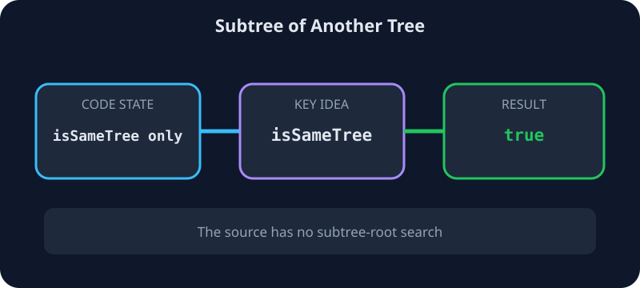

# 45. Subtree of Another Tree

## 1. Problem Statement
The folder is named for checking whether one tree appears inside another, but its C++ file instead compares two complete trees: `{1,2,3}` and `{1,2,3}` return true. Source tests cover structural and value differences; these notes describe the actual `isSameTree` behavior.

## 2. Pattern / Category
Recursive structural tree equality.

## 3. Intuition
The source checks matching roots, then recursively requires corresponding left and right subtrees to match. It never searches for `q` at every node of `p`.


## 4. Brute Force Approach
For the folder's nominal subtree task, a baseline is to test every node of the large tree as a candidate and compare that candidate tree recursively; worst-case O(MN) time and O(H) recursion space. This is not implemented in the source.

## 5. Optimal Approach (My Solution)
The actual method `isSameTree` returns true for two null pointers, false if only one is null or values differ, and otherwise returns the conjunction of recursive comparisons of left and right children. It answers whole-tree equality, not the folder's named subtree question.

Dry run from the source test: `p={1,2,3}` and `q={1,2,3}` have matching roots; comparisons of both children match, and each pair of null grandchildren reaches the both-null base case, so the method returns true.



## 6. Code
```cpp
struct TreeNode {
    int val;
    TreeNode *left;
    TreeNode *right;
    TreeNode() : val(0), left(nullptr), right(nullptr) {}
    TreeNode(int x) : val(x), left(nullptr), right(nullptr) {}
    TreeNode(int x, TreeNode *left, TreeNode *right)
        : val(x), left(left), right(right) {}
};

class Solution {
public:
    bool isSameTree(TreeNode* p, TreeNode* q) {
        if(!p && !q){
            return true;
        }
        if(!p || !q || p->val!=q->val){
            return false;
        }
        return isSameTree(p->left,q->left) && isSameTree(p->right,q->right);
    }
};
```

## 7. Complexity Analysis
For the source's equality comparison, O(n) time when trees match, stopping early on mismatch, and O(h) recursion space. These bounds describe the actual method, not the nominal subtree baseline.

## 8. Edge Cases
- Both null trees compare equal; exactly one null compares false.
- Equal values with different shapes compare false.
- The source test harness uses `-1` as its null marker, but this marker is only in the helper, not the comparison method.

## 9. Common Mistakes / Pitfalls
- Claiming this file searches for a subtree; it has no traversal over candidate nodes.
- Confusing `isSameTree` with an `isSubtree` method.
- Assuming the folder title guarantees the implementation matches the standard problem.

## 10. Key Takeaways
Document the implemented method, including the mismatch between the folder's label and its C++ source.

## 11. Related Problems
- Same Tree
- Subtree of Another Tree
- Symmetric Tree

## 12. 30-Second Interview Explanation
This source does not solve subtree search. It compares two complete trees: both null is true, one null or differing values is false, and otherwise both child pairs must match. The source test `{1,2,3}` against `{1,2,3}` returns true. A real subtree solution would additionally test each node of the larger tree as a possible match.
