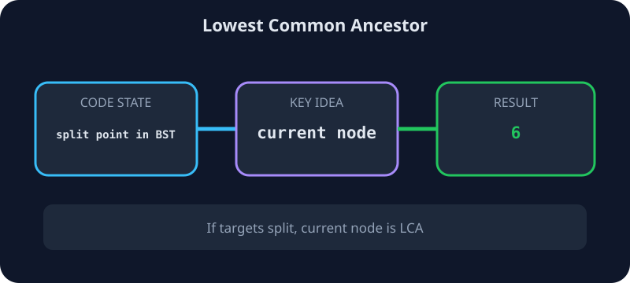

# 46. Lowest Common Ancestor of a Binary Search Tree

## 1. Problem Statement
Given a BST root and two node references, return their lowest common ancestor; in the source BST rooted at 6, nodes 2 and 8 have ancestor 6. Tests include ancestor relationships and identical nodes; valid BST nodes are assumed.

## 2. Pattern / Category
BST value-guided iterative search.

## 3. Intuition
If both target values are smaller than the current node, the LCA must be left; if both are larger, it must be right. Otherwise the current node is the split/ancestor.


## 4. Brute Force Approach
Find paths from root to both nodes and return the last common path node: O(h) time and O(h) path storage. The source avoids path arrays.

## 5. Optimal Approach (My Solution)
`cur` starts at root. The loop moves left when both `p->val` and `q->val` are below `cur->val`, moves right when both are above, and otherwise returns `cur`. If traversal reaches null, it returns nullptr.

Dry run from source test 1: root 6 with nodes 2 and 8 has one value on each side, so neither same-side branch applies and the method returns node 6.



## 6. Code
```cpp
struct TreeNode {
    int val;
    TreeNode *left;
    TreeNode *right;
    TreeNode(int x) : val(x), left(NULL), right(NULL) {}
};

class Solution {
public:
    TreeNode* lowestCommonAncestor(TreeNode* root, TreeNode* p, TreeNode* q) {
        TreeNode* cur = root;
        while (cur){
            if(p->val<cur->val && q->val<cur->val) cur = cur->left;
            else if(p->val>cur->val && q->val>cur->val) cur = cur->right;
            else return cur;
        }
        return nullptr;
    }
};
```

## 7. Complexity Analysis
O(h) time and O(1) auxiliary space, where `h` is the BST height; worst-case O(n) for a skewed tree.

## 8. Edge Cases
- If one node is an ancestor of the other, that node is returned.
- If `p` and `q` are the same node, its own value matches and it is returned.
- The source assumes a BST and valid non-null node pointers.

## 9. Common Mistakes / Pitfalls
- Using this BST logic on an arbitrary binary tree.
- Descending after the values split across the current node.
- Comparing node pointer addresses instead of values in these branches.

## 10. Key Takeaways
BST ordering identifies the LCA as the first node where the target paths split or one target equals it.

## 11. Related Problems
- Lowest Common Ancestor of a Binary Tree
- Validate BST
- Kth Smallest Element in a BST

## 12. 30-Second Interview Explanation
I walk down the BST. If both target values are smaller, I go left; if both are larger, I go right. The first node where they are on opposite sides, or equal to the current node, is their lowest common ancestor. In the source test for values 2 and 8 under root 6, the answer is 6.
