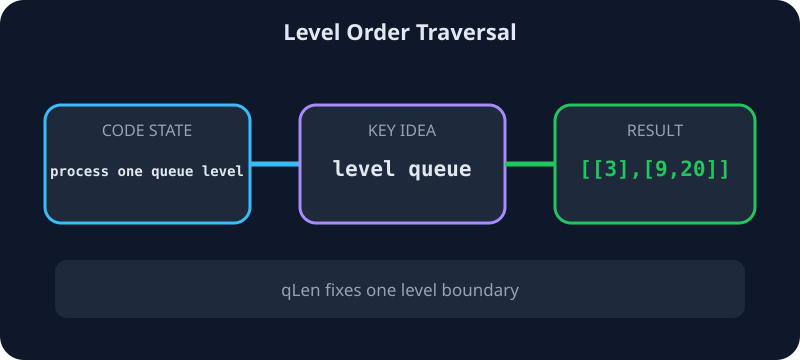

# 47. Binary Tree Level Order Traversal

## 1. Problem Statement
Return node values grouped by depth, left to right; tree `{3,9,20,null,null,15,7}` yields `[[3],[9,20],[15,7]]`. Source tests include empty and skewed trees.

## 2. Pattern / Category
Breadth-first traversal by level.

## 3. Intuition
Capture the current queue length as the level size, process exactly that many entries, and place their non-null children into the next level.


## 4. Brute Force Approach
For each depth, recursively traverse the tree and collect nodes at that depth: O(n·h) time and O(h) recursion space, plus output. This is a baseline, not the source.

## 5. Optimal Approach (My Solution)
The source uses `vector<TreeNode*> q`, initially containing `root`. Each loop saves `qLen`, then reads `q.front()` and removes it with `q.erase(q.begin())`. Non-null nodes append values to `level` and enqueue both children (including null pointers). Nonempty levels are added to `res`.

Dry run for source tree `{3,9,20,-1,-1,15,7}`: first level collects 3 and enqueues 9,20; next level collects 9,20 and enqueues their children; the final nonempty level is `[15,7]`. The result is `[[3],[9,20],[15,7]]`.



## 6. Code
```cpp
struct TreeNode {
    int val;
    TreeNode *left;
    TreeNode *right;
    TreeNode() : val(0), left(nullptr), right(nullptr) {}
    TreeNode(int x) : val(x), left(nullptr), right(nullptr) {}
    TreeNode(int x, TreeNode *left, TreeNode *right)
        : val(x), left(left), right(right) {}
};

class Solution {
public:
    vector<vector<int>> levelOrder(TreeNode* root) {
        vector<vector<int>> res;
        vector<TreeNode*> q;
        q.push_back(root);
        while (q.size()){
            int qLen = q.size();
            vector<int> level;
            for(int i=0; i<qLen; i++){
                TreeNode* node = q.front();
                q.erase(q.begin());
                if (node){
                    level.push_back(node->val);
                    q.push_back(node->left);
                    q.push_back(node->right);
                }
            }
            if(level.size()!=0)
                res.push_back(level);
        }
        return res;
    }
};
```

## 7. Complexity Analysis
The level traversal visits O(n) nodes, but each `q.erase(q.begin())` shifts remaining vector elements, making worst-case time O(n²). Queue storage is O(n) in the worst case (including null children); output is O(n).

## 8. Edge Cases
- Null root is initially queued, then discarded; result is empty.
- A single node produces one level.
- The source enqueues null children but ignores them when popped.

## 9. Common Mistakes / Pitfalls
- Processing children in the current level instead of the next.
- Reporting standard O(n) queue complexity without accounting for vector front erasure.
- Omitting null checks before reading a node's value.

## 10. Key Takeaways
`qLen` separates levels, but `vector::erase(begin())` is costly; a real queue would avoid the shifts.

## 11. Related Problems
- Binary Tree Right Side View
- Average of Levels in Binary Tree
- Zigzag Level Order Traversal

## 12. 30-Second Interview Explanation
I snapshot the current number of queued entries as `qLen`, process those entries as one level, collect non-null values, and enqueue their children for the next level. The source tree returns `[[3],[9,20],[15,7]]`. The implementation uses a vector and erases its front each time, so its worst-case runtime is quadratic rather than the usual linear BFS.
