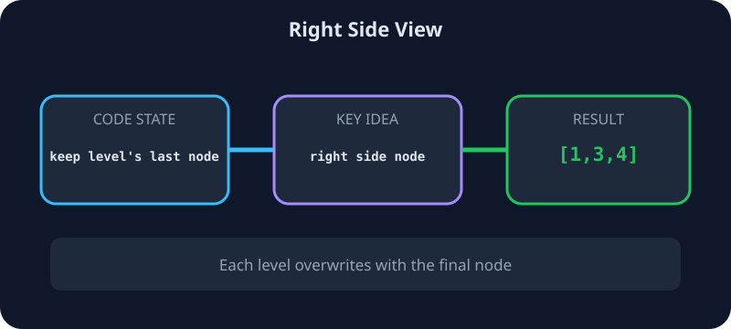

# 48. Binary Tree Right Side View

## 1. Problem Statement
Return the value visible from the right at each depth; source tree `{1,2,3,null,5,null,4}` yields `[1,3,4]`. Tests include empty, skewed, complete, and uneven trees.

## 2. Pattern / Category
Breadth-first traversal by level.

## 3. Intuition
Process each level left to right and retain its final non-null node.


## 4. Brute Force Approach
Traverse once per depth and select the rightmost node at that depth: O(n·h) time and O(h) recursion space. This is a baseline, not the source method.

## 5. Optimal Approach (My Solution)
The source stores pointers in `vector<TreeNode*> q`, beginning with `root`. For each level it saves `qLen` and sets `rightSideNode=NULL`; each non-null node overwrites `rightSideNode` and appends its left and right children. After the level, a non-null `rightSideNode` is added to `res`. Front entries are removed with `q.erase(q.begin())`.

Dry run from source tree `{1,2,3,-1,5,-1,4}`: level 1's last non-null node is 1; level 2 ends with 3; level 3's last non-null node is 4. The answer is `[1,3,4]`.



## 6. Code
```cpp
struct TreeNode {
    int val;
    TreeNode *left;
    TreeNode *right;
    TreeNode() : val(0), left(nullptr), right(nullptr) {}
    TreeNode(int x) : val(x), left(nullptr), right(nullptr) {}
    TreeNode(int x, TreeNode *left, TreeNode *right)
        : val(x), left(left), right(right) {}
};

class Solution {
public:
    vector<int> rightSideView(TreeNode* root) {
        vector<TreeNode*> q;
        q.push_back(root);
        vector<int> res;
        while (q.size()){
            int qLen = q.size();
            TreeNode* rightSideNode = NULL;
            for(int i=0; i<qLen; i++){
                TreeNode* node = q.front();
                q.erase(q.begin());
                if(node){
                    rightSideNode = node;
                    q.push_back(node->left);
                    q.push_back(node->right);
                }
            }
            if (rightSideNode) res.push_back(rightSideNode->val);
        }
        return res;
    }
};
```

## 7. Complexity Analysis
Worst-case O(n²) time because each `q.erase(q.begin())` shifts vector elements; queue storage is O(n) in the worst case, including null child pointers, and output is O(h).

## 8. Edge Cases
- Empty root is queued then ignored, giving an empty result.
- A left-skewed tree returns its only node at each level.
- Null children are ignored; the rightmost non-null node is selected.

## 9. Common Mistakes / Pitfalls
- Assuming the right-side view always consists of right children; an absent right child may expose a left one.
- Capturing the first node in a level rather than the last.
- Describing the source's vector front-removal as O(1).

## 10. Key Takeaways
Track the last non-null node while traversing each level; queue order is left-to-right.

## 11. Related Problems
- Binary Tree Level Order Traversal
- Average of Levels in Binary Tree
- Zigzag Level Order Traversal

## 12. 30-Second Interview Explanation
I process nodes level by level from left to right and overwrite `rightSideNode` for each non-null node. After that level, its last node is the visible one, so I append its value. The source example's level endpoints are 1, 3, and 4. Its vector `erase(begin())` makes worst-case traversal quadratic.
