# 49. Count Good Nodes in Binary Tree

## 1. Problem Statement
Count nodes at least as large as every ancestor on their root path; source tree `{3,1,4,3,null,1,5}` has 4 good nodes. Tests include equal, increasing, and decreasing values; the source expects a non-null root.

## 2. Pattern / Category
Depth-first traversal carrying a path maximum.

## 3. Intuition
Each recursive call needs only the largest value seen so far on its root-to-node path.


## 4. Brute Force Approach
For every node, walk back through its ancestors to check whether any is larger: O(n·h) time and O(h) recursion space. This is a baseline, not the source approach.

## 5. Optimal Approach (My Solution)
`goodNodes` calls `dfs(root,root->val)`. `dfs` returns 0 for null; otherwise it counts the node when `root->val>=maxVal`, updates `maxVal=max(root->val,maxVal)`, and adds recursive counts from left and right.

Dry run from source tree `{3,1,4,3,-1,1,5}`: root 3 is good; node 1 is below path maximum 3; node 4 is good and raises the path maximum to 4; its children 1 and 5 contribute false and true. Total is 4.



## 6. Code
```cpp
struct TreeNode {
    int val;
    TreeNode *left;
    TreeNode *right;
    TreeNode() : val(0), left(nullptr), right(nullptr) {}
    TreeNode(int x) : val(x), left(nullptr), right(nullptr) {}
    TreeNode(int x, TreeNode *left, TreeNode *right)
        : val(x), left(left), right(right) {}
};

class Solution {
    int dfs(TreeNode* root, int maxVal){
        if (!root){
            return 0;
        }
        int res = root->val>=maxVal ? 1 : 0;
        maxVal = max(root->val, maxVal);
        return res + dfs(root->left,maxVal) + dfs(root->right,maxVal);
    }
public:
    int goodNodes(TreeNode* root) {
        return dfs(root,root->val);
    }
};
```

## 7. Complexity Analysis
O(n) time, visiting each node once; O(h) recursion space.

## 8. Edge Cases
- A one-node tree returns 1.
- Equal-to-maximum nodes count because the comparison is `>=`.
- The source public method dereferences `root->val` before `dfs`; it does not handle a null root.

## 9. Common Mistakes / Pitfalls
- Passing only the parent value rather than the maximum over the entire path.
- Using `>` instead of `>=`.
- Claiming null-root safety because `dfs` itself has a null base case.

## 10. Key Takeaways
Carry the path maximum downward and count when the current value meets or exceeds it.

## 11. Related Problems
- Path Sum
- Validate Binary Search Tree
- Binary Tree Maximum Path Sum

## 12. 30-Second Interview Explanation
I traverse with DFS, carrying the largest ancestor value so far. A node is good when its value is at least that maximum; I update the maximum and sum the counts from both children. In the source tree rooted at 3, the good nodes are 3, 4, 3, and 5, so the count is 4. The method assumes a non-null root.
