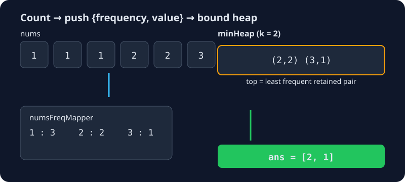

# 5. K Frequent Elements

## 1. Problem Statement
Return `k` values occurring most often in an integer array; for `[1,1,1,2,2,3]` and `k=2`, the answer is the two values 1 and 2. Source tests include negative values and ties; `k` is expected to be valid and tied outputs may differ.

## 2. Pattern / Category
Frequency map + bounded min-heap.

## 3. Intuition
Keep only the `k` most frequent value/frequency pairs while scanning unique values.



## 4. Brute Force Approach
Count with a map and sort all distinct values by frequency: O(n + u log u) time and O(u) space, where `u` is the distinct count. This is a baseline, not the source implementation.

## 5. Optimal Approach (My Solution)
`numsFreqMapper[n]++` counts occurrences. For each map entry, push `{frequency,value}` into `minHeap`; when its size exceeds `k`, pop its smallest pair. Drain heap values into `ans`, so output order is heap order rather than a frequency-descending order.

Dry run from `{1,1,1,2,2,3}, k=2`: counts are `1:3, 2:2, 3:1`. The heap keeps `(2,2)` and `(3,1)` after discarding `(1,3)`, and draining returns `[2,1]`.



## 6. Code
```cpp
class Solution {
public:
    vector<int> topKFrequent(vector<int>& nums, int k) {
      unordered_map<int,int> numsFreqMapper;
      for(int n: nums){
        numsFreqMapper[n]++;
      }
      priority_queue<pair<int,int>,vector<pair<int,int>>,greater<pair<int,int>>> minHeap;
      for(auto& it: numsFreqMapper){
        minHeap.push({it.second,it.first});
        if(minHeap.size()>k){
          minHeap.pop();
        }
      }
      vector<int> ans;
      while (minHeap.size()!=0)
      {
        ans.push_back(minHeap.top().second);
        minHeap.pop();
      }
      return ans;
    }
};
```

## 7. Complexity Analysis
For `n` inputs and `u` distinct values: average O(n + u log k) time and O(u + k) extra space. The frequency map is hash-based (average-case operations); each heap operation is O(log k).

## 8. Edge Cases
- `k=1` keeps one most frequent value.
- Equal frequencies can produce any tied top-k selection; pair ordering also breaks ties by value.
- Source tests use nonempty inputs and valid `k`.

## 9. Common Mistakes / Pitfalls
- Reversing `{frequency,value}` and then reading the wrong pair field.
- Calling this bucket sort: the code actually uses a min-heap.
- Assuming output is sorted by decreasing frequency.

## 10. Key Takeaways
Bound the min-heap at `k`; its top is the least competitive retained pair.

## 11. Related Problems
- Top K Frequent Words
- Kth Largest Element in an Array
- Find K Pairs with Smallest Sums

## 12. 30-Second Interview Explanation
I count values in `numsFreqMapper`, then push each `{frequency,value}` pair into a min-heap. Whenever it grows past `k`, I remove its smallest pair, leaving the top `k` frequencies. Finally I drain the heap's values into `ans`. For the source example, counts 3 and 2 survive while count 1 is removed.
