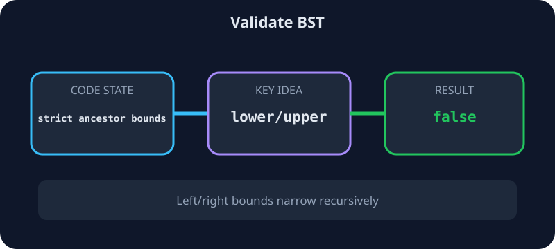

# 50. Validate Binary Search Tree

## 1. Problem Statement
Determine whether every left descendant is smaller and every right descendant larger; `{2,1,3}` is valid, while `{5,1,7,null,null,3,8}` is not. Source tests include duplicates and empty input.

## 2. Pattern / Category
DFS with inherited value bounds.

## 3. Intuition
Each node must obey constraints from all ancestors, not just compare with its immediate parent.


## 4. Brute Force Approach
For each node, find the maximum in its left subtree and minimum in its right subtree, then check them: O(n²) worst-case time and O(h) recursion space. This is a baseline alternative.

## 5. Optimal Approach (My Solution)
`isValidBST` starts `isValid` with `LLONG_MIN` and `LLONG_MAX`. Null nodes return true. A node outside the strict interval (`<=lb` or `>=ub`) fails. The left recursion keeps the lower bound and uses this node as upper bound; the right recursion uses this node as lower bound and keeps the upper bound.

Dry run from source test 4 `{5,1,7,-1,-1,3,8}`: node 3 is inside the right child 7's local range but lies in root 5's right subtree; it violates lower bound 5 and returns false.



## 6. Code
```cpp
struct TreeNode {
    int val;
    TreeNode *left;
    TreeNode *right;
    TreeNode() : val(0), left(nullptr), right(nullptr) {}
    TreeNode(int x) : val(x), left(nullptr), right(nullptr) {}
    TreeNode(int x, TreeNode *left, TreeNode *right)
        : val(x), left(left), right(right) {}
};

class Solution {
    bool isValid(long long lb, TreeNode* root, long long ub){
        if (!root){
            return true;
        }
        if(root->val<=lb || root->val>=ub){
            return false;
        }
        return isValid(lb, root->left, root->val) && isValid(root->val, root->right, ub);
    }
public:
    bool isValidBST(TreeNode* root) {
        return isValid(LLONG_MIN,root,LLONG_MAX);
    }
};
```

## 7. Complexity Analysis
O(n) time in the worst case and O(h) recursion space.

## 8. Edge Cases
- Empty tree is valid by the null base case.
- Duplicate values are invalid because both bounds are strict.
- `long long` sentinels allow integer-valued nodes at the limits of `int`.

## 9. Common Mistakes / Pitfalls
- Comparing each node only with its parent and missing a deeper violation.
- Using inclusive bounds when duplicates are not allowed.
- Using `INT_MIN`/`INT_MAX` bounds if valid node values can equal those extremes.

## 10. Key Takeaways
Pass a valid interval down the tree so every ancestor's ordering constraint is preserved.

## 11. Related Problems
- Kth Smallest Element in a BST
- Lowest Common Ancestor of a BST
- Recover Binary Search Tree

## 12. 30-Second Interview Explanation
I recursively pass an allowed `(lb,ub)` range. A node must be strictly inside it; the left child receives the node value as its upper bound, and the right child receives it as its lower bound. In the source deeper-node test, value 3 violates root 5's lower bound, so the tree is invalid.
