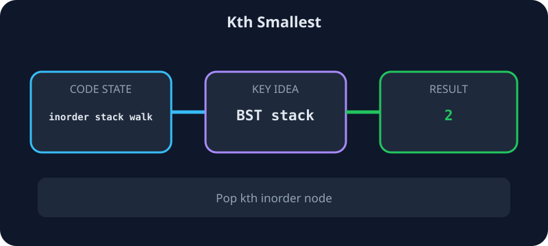

# 51. Kth Smallest Element in a BST

## 1. Problem Statement
Return the kth smallest value in a BST; in source tree `{3,1,4,null,2}`, `k=2` returns 2. Tests include first/last values and one-node trees; the input is assumed to be a BST.

## 2. Pattern / Category
Iterative inorder traversal.

## 3. Intuition
Inorder visits BST values in ascending order; stop when the kth node is popped.


## 4. Brute Force Approach
Traverse the full tree inorder into an array, then select index `k-1`: O(n) time and O(n) extra space. The source stops early using a stack.

## 5. Optimal Approach (My Solution)
`curr` descends left while pushing nodes onto stack `s`. It then pops the next inorder node, increments `n`, and returns its value when `n==k`; otherwise it moves to that node's right child. If traversal ends first, it returns `-1`.

Dry run from source tree `{3,1,4,-1,2}`, `k=2`: descend through 3 to 1, pop 1 (`n=1`), move to 1's right child 2, pop 2 (`n=2`), and return 2.



## 6. Code
```cpp
struct TreeNode {
    int val;
    TreeNode *left;
    TreeNode *right;
    TreeNode() : val(0), left(nullptr), right(nullptr) {}
    TreeNode(int x) : val(x), left(nullptr), right(nullptr) {}
    TreeNode(int x, TreeNode *left, TreeNode *right)
        : val(x), left(left), right(right) {}
};

class Solution {
public:
    int kthSmallest(TreeNode* root, int k) {
        stack<TreeNode*> s;
        TreeNode* curr = root;
        int n = 0;
        while(curr || !s.empty()){
            while(curr){
                s.push(curr);
                curr = curr->left;
            }
            curr = s.top();
            s.pop();
            n+=1;
            if(n==k){
                return curr->val;
            }
            curr = curr->right;
        }
        return -1;
    }
};
```

## 7. Complexity Analysis
O(h+k) time before an early return (O(n) worst case) and O(h) stack space.

## 8. Edge Cases
- `k=1` returns the smallest value.
- A one-node tree returns that value for `k=1`.
- If traversal finishes before `k` nodes, the source returns `-1`; normal input assumes valid `k`.

## 9. Common Mistakes / Pitfalls
- Using preorder or level order, which is not sorted.
- Incrementing the visit count when pushing rather than when popping in inorder.
- Assuming a missing kth node is signaled by an exception; this code returns `-1`.

## 10. Key Takeaways
An explicit stack reproduces recursive inorder and supports early termination.

## 11. Related Problems
- Validate Binary Search Tree
- Lowest Common Ancestor of a BST
- Binary Search

## 12. 30-Second Interview Explanation
I perform iterative inorder traversal with a stack: push the whole left chain, pop the next smallest node, count it, and then traverse its right subtree. When the count reaches `k`, I return that value. In the source tree, the ordered values begin 1,2, so the second-smallest is 2.
