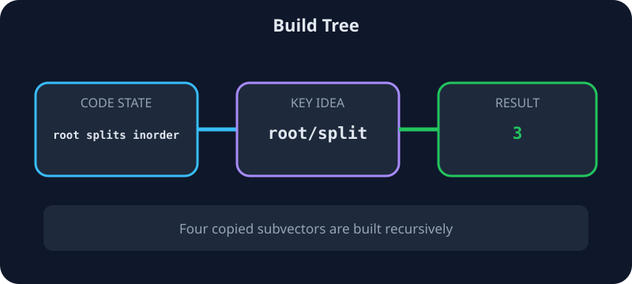

# 52. Construct Binary Tree from Preorder and Inorder Traversal

## 1. Problem Statement
Reconstruct a binary tree from preorder and inorder; `[3,9,20,15,7]` and `[9,3,15,20,7]` produce root 3 with left child 9 and right subtree rooted at 20. Tests include skewed and empty cases; values are assumed unique and traversals consistent.

## 2. Pattern / Category
Divide and conquer with traversal slicing.

## 3. Intuition
The first preorder value is the root; its index in inorder separates left and right subtree values.


## 4. Brute Force Approach
Try possible roots and partitions recursively without an index lookup, scanning inorder at each level: O(n²) worst-case time. This source also uses a linear search, so it has the same worst-case time but explicitly copies slices.

## 5. Optimal Approach (My Solution)
`buildTree` returns null if either vector is empty. It creates a root from `preorder[0]`, finds that value in `inorder`, and stores its index in `mid`. It allocates four vectors for left/right preorder and inorder portions, copies values into them, recursively builds left, then right, and returns root. The implementation assumes valid traversals with unique values.

Dry run from source example `preorder=[3,9,20,15,7]`, `inorder=[9,3,15,20,7]`: root is 3; its inorder index 1 makes `[9]` the left subtree, while `[20,15,7]` / `[15,20,7]` form the right subtree.



## 6. Code
```cpp
struct TreeNode {
    int val;
    TreeNode *left;
    TreeNode *right;
    TreeNode() : val(0), left(nullptr), right(nullptr) {}
    TreeNode(int x) : val(x), left(nullptr), right(nullptr) {}
    TreeNode(int x, TreeNode *left, TreeNode *right)
        : val(x), left(left), right(right) {}
};

class Solution {
public:
    TreeNode* buildTree(vector<int>& preorder, vector<int>& inorder) {
        if(!preorder.size() || !inorder.size()) return NULL;
        int num = preorder[0];
        TreeNode* root = new TreeNode(num);
        auto it = find(inorder.begin(), inorder.end(), num);
        int mid = distance(inorder.begin(), it);
        vector<int> leftPreorder(mid), leftInorder(mid), rightInorder(inorder.size() - mid - 1), rightPreorder(preorder.size() - mid - 1);
        copy(preorder.begin() + 1, preorder.begin() + mid + 1, leftPreorder.begin());
        copy(inorder.begin(), inorder.begin() + mid, leftInorder.begin());
        root->left = buildTree(leftPreorder, leftInorder);
        copy(preorder.begin() + mid + 1, preorder.end(), rightPreorder.begin());
        copy(inorder.begin() + mid + 1, inorder.end(), rightInorder.begin());
        root->right = buildTree(rightPreorder, rightInorder);
        return root;
    }
};
```

## 7. Complexity Analysis
O(n²) worst-case time from repeated linear `find` plus copying sub-vectors; balanced inputs take about O(n log n). Slice storage can total O(n²) in a skewed tree, plus O(n) output nodes.

## 8. Edge Cases
- Empty traversal vectors return null.
- A single value creates one node.
- The code assumes matching traversal contents and distinct values; it does not validate mismatches or duplicate values.

## 9. Common Mistakes / Pitfalls
- Taking the root from inorder rather than preorder.
- Slicing preorder at the wrong count: left subtree size is `mid`.
- Assuming the source uses an index map; it calls `find` and copies vectors.

## 10. Key Takeaways
Preorder identifies each root; inorder gives the left-subtree size and partition.

## 11. Related Problems
- Construct Binary Tree from Inorder and Postorder Traversal
- Serialize and Deserialize Binary Tree
- Same Tree

## 12. 30-Second Interview Explanation
I take the first preorder value as root and find it in inorder. The number of values before that index is the left-subtree size, so I copy the corresponding preorder/inorder slices and recurse on both sides. For the source example, root 3 splits off left node 9 and leaves `[20,15,7]` for the right subtree.
