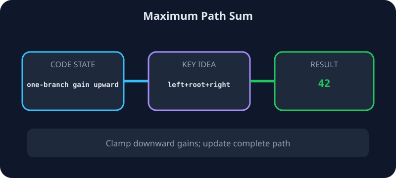

# 53. Binary Tree Maximum Path Sum

## 1. Problem Statement
Find the maximum sum along any nonempty parent-child path; tree `{-10,9,20,null,null,15,7}` has maximum 42. Source tests include all-negative trees and paths excluding the root; the code assumes a non-null tree.

## 2. Pattern / Category
Postorder DFS with global best.

## 3. Intuition
Each node can return only one downward branch to its parent, but a complete best path through it can combine both branches.


## 4. Brute Force Approach
For every node, compute the best downward path on both sides and use that node as a path peak: O(n²) worst-case time and O(h) recursion space. This is a baseline, not the source implementation.

## 5. Optimal Approach (My Solution)
`maxPathSum` initializes member `result` to `root->val`, calls `dfs`, and returns it. `dfs` returns 0 for null; otherwise it gets left/right gains, clamps each to at least 0, updates `result` with `root->val+leftMax+rightMax`, and returns `root->val+max(leftMax,rightMax)` so the parent receives one branch only.

Dry run for source tree `{-10,9,20,-1,-1,15,7}`: node 20 contributes 15+20+7=42 as a path peak; its returned downward gain is 35. The root's `-10` does not improve the stored result, so the function returns 42.



## 6. Code
```cpp
struct TreeNode {
    int val;
    TreeNode *left;
    TreeNode *right;
    TreeNode() : val(0), left(nullptr), right(nullptr) {}
    TreeNode(int x) : val(x), left(nullptr), right(nullptr) {}
    TreeNode(int x, TreeNode *left, TreeNode *right)
        : val(x), left(left), right(right) {}
};

class Solution {
    int result = 0;
public:
    int dfs(TreeNode* root){
        if (!root){
            return 0;
        }
        int leftMax = dfs(root->left);
        int rightMax = dfs(root->right);
        leftMax = max(leftMax,0);
        rightMax = max(rightMax,0);
        result = max(result, root->val+leftMax+rightMax);
        return root->val+max(leftMax,rightMax);
    }
    int maxPathSum(TreeNode* root) {
        result = root->val;
        dfs(root);
        return result;
    }
};
```

## 7. Complexity Analysis
O(n) time and O(h) recursion space.

## 8. Edge Cases
- All-negative values work because gains are clamped to 0 while `result` starts at the root value.
- A one-node tree returns that value.
- The public method dereferences `root->val`; null root is not handled.

## 9. Common Mistakes / Pitfalls
- Returning both child gains to the parent, which would branch into two directions.
- Clamping the global answer to 0, which fails for all-negative trees.
- Forgetting that the best path need not include the root.

## 10. Key Takeaways
Use a two-branch sum to update the global answer and a one-branch sum to return upward.

## 11. Related Problems
- Binary Tree Diameter
- Path Sum
- Maximum Product Subarray

## 12. 30-Second Interview Explanation
Postorder DFS computes each child's best downward gain, discarding negative gains. At each node I combine both positive gains with its value to update the global path maximum, then return only the larger branch to its parent. In the source tree, the path 15-20-7 totals 42. The input must be nonempty because the method initializes from `root->val`.
