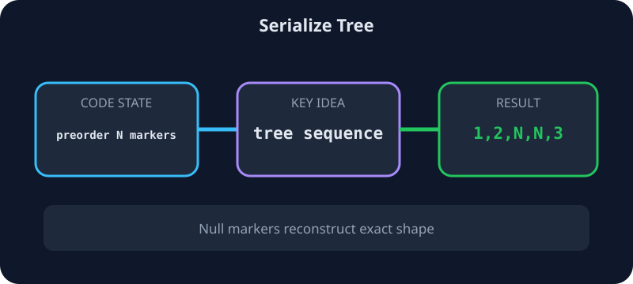

# 54. Serialize and Deserialize Binary Tree

## 1. Problem Statement
Convert a binary tree to a string and reconstruct it; the source tree with root 1, children 2 and 3, and 3's children 4 and 5 serializes to `1,2,N,N,3,4,N,N,5,N,N`. Tests include empty, skewed, and negative-valued trees.

## 2. Pattern / Category
Preorder DFS with explicit null markers.

## 3. Intuition
Record every node in preorder and mark null children so the decoder can recover the exact tree shape.


## 4. Brute Force Approach
Serialize level order with child placeholders and decode by consuming a queue: O(n) time and O(n) string/token storage. This is a baseline alternative; the source uses recursive preorder.

## 5. Optimal Approach (My Solution)
The encoding `dfs(TreeNode*)` appends `"N"` for null or the node value followed by left and right encodings. `vTos` joins tokens with commas; `serialize` clears `treeSequence` after joining. For decoding, `split` creates `nodesSequence`, `i=0`, and the other `dfs()` consumes one token: `"N"` returns null, otherwise it builds a node then recursively assigns left and right. `deserialize` clears tokens after reconstruction.

Dry run from source test 1: root 1 with left 2 and right 3 (whose children are 4 and 5) yields preorder tokens `1,2,N,N,3,4,N,N,5,N,N`, which are joined with commas.



## 6. Code
```cpp
struct TreeNode {
    int val;
    TreeNode *left;
    TreeNode *right;
    TreeNode(int x) : val(x), left(NULL), right(NULL) {}
};

class Codec {
    vector<string> treeSequence;
    vector<string> nodesSequence;
    int i;
    void dfs(TreeNode * root){
        if (!root){
            treeSequence.push_back("N");
            return;
        }
        treeSequence.push_back(to_string(root->val));
        dfs(root->left);
        dfs(root->right);
    }
    TreeNode* dfs(){
        if(nodesSequence[i]=="N"){
            i++;
            return NULL;
        }
        TreeNode* root = new TreeNode(stoi(nodesSequence[i++]));
        root->left = dfs();
        root->right = dfs();
        return root;
    }
    vector<string> split(string str, char delimiter){
        vector<string> tokens;
        string token;
        stringstream ss(str);
        while(getline(ss,token,delimiter)){
            tokens.push_back(token);
        }
        return tokens;
    }
    string vTos(vector<string> s){
        string str = "";
        for(int i=0; i<s.size(); i++){
            str += s[i];
            if(i!=s.size()-1){
                str += ",";
            }
        }
        return str;
    }
public:
    // Encodes a tree to a single string.
    string serialize(TreeNode* root) {
        dfs(root);
        string s = vTos(treeSequence);
        treeSequence.clear();
        return s;
    }
    // Decodes your encoded data to tree.
    TreeNode* deserialize(string data) {
        nodesSequence = split(data, ',');
        i = 0;
        TreeNode* root = dfs();
        nodesSequence.clear();
        return root;
    }
};
```

## 7. Complexity Analysis
O(n) time and O(n) serialized/token storage for `n` tree nodes (including `n+1` null child markers); recursive call stack is O(h).

## 8. Edge Cases
- A null tree serializes as `"N"` and decodes to null.
- Negative values are parsed with `stoi`.
- The decoder assumes well-formed data; it does not check token bounds or malformed values.

## 9. Common Mistakes / Pitfalls
- Omitting null markers loses structural information.
- Using a different traversal order for encode and decode.
- Failing to reset member token vectors between calls; the source clears them.

## 10. Key Takeaways
A deterministic traversal plus explicit null tokens makes the tree shape unambiguous.

## 11. Related Problems
- Construct Binary Tree from Preorder and Inorder Traversal
- Serialize and Deserialize N-ary Tree
- Copy List with Random Pointer

## 12. 30-Second Interview Explanation
I serialize preorder values and write `"N"` for each missing child, joining tokens with commas. During decoding, I consume tokens in the same order: an `N` is null; otherwise I create a node and recursively build left then right. The source's root-1 tree starts `1,2,N,N,3,N,N`, preserving both children and null structure.
